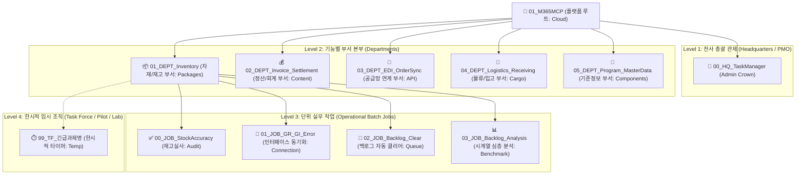

# ACME Manufacturing M365 Automation Organization Ground Rules
## (전사 조직 위계, 명명 규칙 및 Catppuccin 아이콘 표준 지침)

본 문서는 ACME Manufacturing (Plant P001 Headlamp & P002) M365 AI 자동화 플랫폼(`01_M365MCP`) 산하의 **모든 가상 조직, 부서, 실무 작업(Batch Job) 및 임시 조직(TF)의 신규 생성, 명명, 파일 구조 및 Catppuccin 아이콘 매핑에 관한 전사 표준 지침(Ground Rule)**입니다.

모든 개발자, 운영자 및 AI 에이전트는 새로운 부서나 작업을 신설할 때 본 규칙을 예외 없이 준수해야 합니다.

---

## 🏛️ 1. 조직 4대 계층 구조 (4-Tier Hierarchy)



---

## 🏷️ 2. 폴더 명명 규칙 (Folder Naming Conventions)

탐색기(Explorer)를 모두 펼쳤을 때 인지 부하를 최소화하고, 정렬 시 계층이 자동으로 묶이도록 **대문자 전치형 접두사(Prefix)**를 엄격히 적용합니다.

| 계층 레벨 | 명명 규칙 (Format) | 예시 | 필수 포함 내용 |
| :--- | :--- | :--- | :--- |
| **Level 1 (HQ)** | `00_HQ_<본부명>` | `00_HQ_TaskManager` | 전사 스케줄링 총괄, 통합 모니터링(`pipeline_monitor.py`), 아침 브리핑 |
| **Level 2 (DEPT)** | `<순번>_DEPT_<영문부서명>` | `01_DEPT_Inventory`<br>`02_DEPT_Invoice_Settlement`<br>`04_DEPT_Logistics_Receiving` | 부서 총괄 README, 부서 내 공통 스토리지 보존(`storage_retention.py`), 부서 산하 Job 집합 |
| **Level 3 (JOB)** | `<순번>_JOB_<영문실무작업명>` | `00_JOB_StockAccuracy`<br>`01_JOB_GR_GI_Error`<br>`02_JOB_Backlog_Clear`<br>`03_JOB_Backlog_Analysis` | 단일 독립 배치 자동화 작업. 실행 배치파일(`run_*.bat`), 엔트리포인트(`run_*.py`), 자체 DB |
| **Level 4 (TF)** | `99_TF_<임시과제명>` | `99_TF_Emergency_Audit`<br>`99_TF_Backlog_Discrepancy` | 1개월 미만 한시적 태스크포스, 파일럿 테스트, 스크래치 디버깅 |

---

## 🎨 3. Catppuccin 폴더 아이콘 배정 규칙

Catppuccin Icons (`catppuccin-mocha`) 테마 기준으로, 각 계층의 성격에 부합하는 아이콘 심볼과 테마 컬러를 고정 적용합니다.

### (1) 상위 조직 및 부서 (Level 1 & 2)
* `00_HQ_*`: 🛡️ **`folder_admin`** (Blue: 전사 관제 왕관 & 방패)
* `01_DEPT_Inventory`: 📦 **`folder_packages`** (Peach: 자재/재고 물류 거점)
* `02_DEPT_Invoice_Settlement`: 📑 **`folder_content`** (Sky: 회계 원장 및 정산 본부)
* `03_DEPT_EDI_OrderSync`: 🔌 **`folder_api`** (Yellow: 공급망 EDI 통신 본부)
* `04_DEPT_Logistics_Receiving`: 🚛 **`folder_cargo`** (Peach: 대형 화물트럭 본부)
* `05_DEPT_Program_MasterData`: 🧩 **`folder_components`** (Peach: BOM 부품 마스터 본부)

### (2) 실무 작업 (Level 3 - JOB)
* 실사/검증 작업: ✅ **`folder_audit`** (Green: 체크리스트 클립보드)
* 실시간 동기화/인터페이스: 🔗 **`folder_connection`** (Teal: 24/7 통신 링크)
* 대기열/백로그 처리: 📑 **`folder_queue`** (Sky: 작업 큐 스택)
* 통계/시계열 데이터 분석: 📊 **`folder_benchmark`** (Peach: 성능 계측기 및 게이지)
* 기타 프로세스 파이프라인: ⚙️ **`folder_workflows`** (Peach: 프로세스 노드)

### (3) 임시 조직 및 스크래치 (Level 4 - TF)
* 모든 임시 폴더(`99_TF_*`, `TF_*`, `temp`, `scratch`, `pilot`, `sandbox`): ⏱️ **`folder_temp`** (Teal: 시계/타이머 달린 한시적 임시 폴더)

### (4) 내부 데이터 및 감사 폴더
* 데이터베이스 폴더 (`db`): 🗄️ **`folder_database`** (Yellow DB)
* 도메인 마스터/온톨로지 (`ontology`): ⚛️ **`folder_core`** (Overlay Atom)
* 보고서 및 감사 로그 (`reports`, `resolution_logs`, `audit_reports`): 📄 **`folder_docs`**
* 시스템 감사 로그 (`logs`): 🔒 **`folder_security`** (Flamingo Shield)

---

## ⚡ 4. 파이썬 파일 아이콘 배정 규칙 (`associations.files`)

탐색기에서 파일 목록을 보았을 때, 일반 뱀 로고(🐍) 대신 파일의 역할을 즉각 식별할 수 있도록 전용 아이콘을 부여합니다.

| 파일명 패턴 | 지정 아이콘 | 시각적 의미 및 용도 |
| :--- | :---: | :--- |
| `run_*.py`<br>`pipeline_monitor.py` | 🚀 **`rocket`** | **실행 엔트리포인트 (Launchers)**: 스케줄러나 사용자가 직접 호출하는 시작 파일 |
| `*_engine.py`<br>`*_resolver.py` | ⚡ **`zap`** | **핵심 연산/처리 엔진 (Core Engines)**: 실시간 자동포스팅, 델타 계산, 백로그 해소 알고리즘 |
| `*_analysis.py`<br>`analytics_*.py` | 📊 **`benchmark`** | **정량 분석기 (Analytics)**: 시계열 분석, 사분면 매트릭스 산출, 통계 집계 |
| `*_operator.py`<br>`*_crawler.py` | 🤖 **`robots`** | **RPA 자동화 봇 (RPA Bots)**: SAP GUI 조작(`sap_operator.py`), WMS 웹 크롤링(`wms_crawler.py`) |
| `*_generator.py`<br>`*_notifier.py` | ⚙️ **`workflow`** | **파이프라인 출력기 (Outputs)**: HTML 리포트 생성, Outlook 이메일/Teams 알림 전송 |
| `db_manager.py`<br>`*_db.py` | 🗄️ **`database`** | **데이터베이스 인터페이스**: SQLite 트랜잭션 및 WAL 관리 |
| `config.py`<br>`graph_client.py` | ⚙️ / 🐍 | 일반 환경설정 및 API 헬퍼 (기본 유지) |

---

## 📋 5. 신규 부서 및 Job 생성 시 5대 필수 파일 체크리스트

새로운 부서(`DEPT`)나 실무 작업(`JOB`)을 신설할 때는 반드시 다음 구조를 갖추어야 합니다:

### (1) 신규 부서 (`XX_DEPT_이름`) 필수 구성:
1. `README.md`: 부서 목표, RACI 매트릭스, 산하 Job 목록, 가상 조직도
2. `storage_retention.py`: 부서 산하 대용량 엑셀/데이터 7일~14일 보존 및 자동 Prune 엔진

### (2) 신규 작업 (`XX_JOB_이름`) 필수 구성:
1. `README.md`:
   - 대상 공장 (`P001` or `P002`), 실행 주기(EST 기준 시각 및 요일), 선행 조건
   - 공식 수신인(TO) 및 참조인(CC) 이메일 명시
2. `run_<작업명>_pipeline.bat`:
   - Windows Task Scheduler 등록용 무인 실행 배치 파일
   - 반드시 `cd /d "%~dp0"` 또는 절대 경로 명시 및 headless 실행 옵션 포함
3. `run_<작업명>.py`:
   - 메인 실행 엔트리포인트 (CLI 인자 파싱 및 전체 흐름 조율)
4. `db/`:
   - 영구 적재용 SQLite 데이터베이스 디렉터리 (WAL 모드 필수 적용)
5. `reports/` 또는 `resolution_logs/`:
   - 일일 실행 결과 및 감사 추적용 로그 산출 디렉터리

---

## 🛠️ 6. 자동화 관리 도구: `org_manager.py`

본 Ground Rule을 자동으로 유지하고 신규 생성 시 즉시 등록할 수 있도록 `00_HQ_TaskManager/org_manager.py` 도구를 제공합니다.

* **전체 조직 현황 조회**:
  ```bash
  python 00_HQ_TaskManager/org_manager.py list
  ```
* **아이콘 및 테마 전체 자동 동기화**:
  ```bash
  python 00_HQ_TaskManager/org_manager.py sync-icons
  ```
* **신규 부서 스캐폴딩**:
  ```bash
  python 00_HQ_TaskManager/org_manager.py create-dept <부서영문명> --icon <icon_name>
  ```
* **신규 실무 작업(Job) 스캐폴딩**:
  ```bash
  python 00_HQ_TaskManager/org_manager.py create-job <소속DEPT> <Job영문명> --icon <icon_name>
  ```
* **Git 보안 스캔 및 원격 자동 동기화**:
  ```bash
  python 00_HQ_TaskManager/org_manager.py sync-git -m "변경 요약 메시지"
  ```

---

## 🔒 7. Git 버전 관리 및 민감 데이터 무해화 표준 (Git Backup & Data Sanitization Standard)

모든 코드 작업물은 공개 정화 스냅샷 저장소(`https://github.com/Miaou360/manufacturing-agent-org.git`, 운영 원본은 비공개 별도 저장소)에 백업 및 동기화하되, **사내 보안 정책과 개인정보/기밀 데이터 보호를 위해 다음 무해화 원칙을 필수로 준수**합니다:

1. **사내 이메일 도메인(`*@corp.example.com`) 및 실명 원천 배제**:
   - 코드 및 문서 상에 실제 동료/본인의 이메일 주소를 직접 기재하지 않습니다.
   - 모든 알림 수신처는 로컬 전용 `.env`에 정의하고, 코드에서는 `os.getenv("VARIABLE", "user_placeholder")` 형태로 환경변수를 통해 동적 주입합니다.
2. **원천 데이터베이스 및 대용량 파일 제외**:
   - SQLite DB(`inventory_history.db` 등), 엑셀/CSV 덤프 파일(`*.xlsx`, `*.xls`), 로그 파일은 `.gitignore`를 통해 Git 추적에서 배제합니다.
   - 코드가 다른 PC에서 클론되더라도 `db_manager.py`의 `CREATE TABLE IF NOT EXISTS`가 빈 데이터베이스와 테이블을 자동 생성하므로 정상 구동됩니다.
3. **온톨로지 및 대용량 실적 데이터의 정크 치환**:
   - 3.9만 줄의 실 품목 온톨로지와 같은 실적 데이터는 로컬에만 보관하고, 저장소에는 스키마 규격을 정의하는 가상 정크 데이터(`material_turnover_ontology.example.json`)만 커밋합니다.
4. **자동 보안 감사 파이프라인**:
   - `python 00_HQ_TaskManager/git_auto_sync.py scan`을 통해 커밋 전 민감 정보 유출 여부를 상시 점검합니다.

---

## 🛡️ 8. 전사 무충돌 파일 타임스탬프 및 SAP GUI 자율 자가치유 표준 (Universal Zero-Collision Timestamp & SAP Self-Healing Standard)

전사(`01_M365MCP`) 산하 모든 부서 및 실무 작업(JOB)에서 **웹 크롤링(WMS 등), SAP 내보내기(ZTCODE_STOCK_REC, MB52 등), 엑셀/CSV 리포트 생성, DB 덤프 등 모든 파일 저장 작업 시 다음 3대 표준을 의무 적용**합니다:

1. **전사 무충돌 고유 타임스탬프(`_YYYYMMDD_HHMMSS`) 의무 작명 원칙**:
   - **적용 범위**: 웹 브라우저 크롤러 다운로드, SAP GUI 파일 내보내기(`System -> List -> Save -> Local file`), 배치 리포트 생성, DB 백업 등 추후 생성될 모든 파일 저장 작업에 전면 적용.
   - **명명 규격**: 1차 파일 저장 시 반드시 `[업무명]_[YYYYMMDD_HHMMSS].[확장자]` 형태로 초 단위 고유 타임스탬프를 부여합니다.
   - **효과**: (1) SAP `wnd[2]` ("파일이 이미 존재합니다. 덮어쓰시겠습니까?") 모달 팝업 원천 차단, (2) 웹 브라우저의 `파일명 (1).xlsx` 중복 파일 생성 방지, (3) 다중 프로세스 간 `File In Use` 락 충돌 방지.
   - **대표 파일 갱신**: 저장이 완료된 후 후속 파이프라인 연계를 위해 `shutil.copyfile()`로 당일 대표 파일(`[업무명]_[YYYYMMDD].[확장자]`) 또는 최신 파일(`[업무명]_latest.[확장자]`)로 복사 갱신합니다.
   - **공통 함수**: `from sap_healer import get_safe_timestamped_path`

2. **런타임 능동형 자가치유 (Active Self-Healing Watchdog)**:
   - 스크립트 실행 중 타임아웃 또는 블로킹 발생 시, 백그라운드 자가치유 엔진(`sap_healer.py`)이 데스크톱 윈도우(`WinSta0`/`Default`)를 자동 스캔하여 다음 팝업을 즉각 처리합니다:
     - **SAP GUI Security 권한 요청**: `Remember My Decision` 자동 체크 후 `Allow` 자동 클릭.
     - **SAP GUI Security 차단 알림**: `No` 닫기 후 `%APPDATA%\SAP\Common\saprules.xml`의 차단(Deny) 규칙을 자동 삭제하고 작업 폴더를 쓰기 허용(`Allow`)으로 동적 패치.
     - **정보/확인성 모달 다이얼로그 (`wnd[1]`, `wnd[2]`)**: 엔터(`VK_RETURN`) 또는 확인(`btn[0]`)으로 자동 통과.
     - **세션 끊김 / 킥아웃 (#32770)**: 팝업 닫기 후 `Enterprise SSO` 자동 콜드스타트로 세션 자율 복구.
   - 공통 실행기: `from sap_healer import run_healed_sap_vbs`

3. **블랙박스 진단 로그 및 학습 (Blackbox Diagnostic & Learning)**:
   - 기존 룰셋에 없는 미지의 신규 팝업 발생 시, 화면 전체 또는 해당 창의 **스크린샷을 자동 캡처**(`00_HQ_TaskManager/reports/popups/unknown_popup_*.png`)하고 창 텍스트와 컨트롤 정보를 JSON(`popup_history.json`)에 기록하여 추후 즉각적인 자가치유 룰 추가가 가능하도록 진단 데이터를 보존합니다.

---

## 11. 운영 보고서 영어 전용 원칙 (D111 — Report Language, English-Only for Operational Recipients)

> **D111 — Report language.** Any report, email, attachment, or sheet whose recipients (TO/CC) include anyone other than the user must be written **entirely in English** — subject, body, table headers, cause labels, banners, notes, and Excel sheet/column names. Reports sent to the user only (`TEST_EMAIL_RECIPIENT`, `[TEST]`, `[수시]`, 03 user-only analysis) may use Korean. New cause codes/labels must be defined with an English display label first. Every notifier must pass the Hangul check before merge.

- **라벨 단일 관리**: 공통 원인 라벨은 `01_DEPT_Inventory/report_labels.py`의 `EN` 사전에서만 정의합니다(코드·DB 값은 코드값 그대로, 표시 라벨만 영어).
- **테스트 가드**: 각 notifier 렌더 결과(제목·HTML·엑셀 시트/열)에 한글(U+AC00–U+D7A3, U+1100–U+11FF, U+3130–U+318F) 0개를 `assert_no_hangul()`로 검증합니다.
- **실행 가드**: 운영 수신자 발송 직전 `check_report_language()` 실행 — 한글 발견 시 **발송은 계속**하고 로그 + `.agents/handoff/ALERT_LANG_*.md`를 남깁니다.
