# 00_HQ_TaskManager (오케스트레이션 및 총괄 관제 본부)

`00_HQ_TaskManager`는 ACME Manufacturing 자재관리(Materials Team)의 복합적인 일상 업무를 체계화하고, M365 AI 에이전트와 도메인별 가상 팀들을 총괄 지휘하는 **PMO (Project Management Office) / 오케스트레이터 본부**입니다.

---

## 🛡️ ACME Manufacturing 자재관리 가상 조직도 (Virtual Teams Org Chart)

```mermaid
graph TD
    classDef live fill:#15803d,stroke:#166534,stroke-width:2px,color:#ffffff;
    classDef inprog fill:#b45309,stroke:#92400e,stroke-width:2px,color:#ffffff;
    classDef planned fill:#475569,stroke:#334155,stroke-width:2px,color:#ffffff;
    classDef pmo fill:#1e3a8a,stroke:#172554,stroke-width:3px,color:#ffffff;

    TM["00_HQ_TaskManager (PMO & Dispatcher)"]:::pmo

    TM --> INV["01_DEPT_Inventory (자재/재고 부서 본부)"]:::live
    TM --> INV_SET["02_DEPT_Invoice_Settlement (송장 정산/SAP 회계)"]:::planned
    TM --> EDI["03_DEPT_EDI_OrderSync (발주/EDI 동기화)"]:::planned
    TM --> LOG["04_DEPT_Logistics_Receiving (입고/도크/물류)"]:::planned
    TM --> MD["05_DEPT_Program_MasterData (BOM/사일로/마스터)"]:::planned

    INV --> SA["00_JOB_StockAccuracy (재고 정확도/순환실사)<br><b>[🟢 LIVE - Daily 04:00 AM]</b>"]:::live
    INV --> GGE["01_JOB_GR_GI_Error (24시간 무중단 자동 해소)<br><b>[🟢 LIVE - 24/7 Daemon (주간 30m / 야간 1h)]</b>"]:::live
    INV --> BL["02_JOB_Backlog_Clear (COGI 생산 백로그 실시간 해소)<br><b>[🟢 LIVE - Daily 06:10 / 08:15 AM]</b>"]:::live
    INV --> BLA["03_JOB_Backlog_Analysis (COGI 시계열 4대차원 심층 분석)<br><b>[🟢 LIVE - Weekly / Milestone 10/31]</b>"]:::live
    INV --> REC["04_JOB_SystemReconciliation (WMS vs SAP 전사 시스템 공식 정확도)<br><b>[🟢 LIVE - Daily 06:35 AM]</b>"]:::live

    INV_SET --> INV_SUB["부품 협력사 송장 대사 / MIGO-MIRO"]:::planned
    EDI --> EDI_SUB["EDI_Gateway_A EDI / 830-862 vs SAP ZTCODE_ORDER_SYNC"]:::planned
    LOG --> LOG_SUB["트럭 입고 예약 / 벌크 컨테이너 ETA"]:::planned
    MD --> MD_SUB["수지 사일로 배정 / 양산 BOM 변경"]:::planned
```



---

## 📊 부서별 운영 현황 매트릭스 (Departments & Jobs Status Board)

| 도메인 팀 | 담당 영역 | 운영 상태 | 주요 스크립트 및 산출물 | 정기 스케줄 |
| :--- | :--- | :---: | :--- | :--- |
| **00_HQ_TaskManager**<br>(오케스트레이션) | 총괄 PMO, 아침 브리핑, 팔로우업 추적, 자동화 파이프라인 통합 관제, Git 보안 동기화 | **🟢 LIVE** | `daily_briefing.py`<br>`follow_up_tracker.py`<br>`org_manager.py`<br>`git_auto_sync.py` | 매일 아침 수시 / 통합 관제 |
| **01_DEPT_Inventory**<br>├ **00_JOB_StockAccuracy** | 재고 정확도 검증, 회전일수 온톨로지, 순환실사(40 Bins) 알림 | **🟢 LIVE** | `daily_pipeline.py`<br>`box_aging_tracker.py`<br>`stock_verifier.py`<br>`warehouse_notifier.py` | 월~토 04:00 AM EST<br>(일요일 발송 제외 정책) |
| **01_DEPT_Inventory**<br>├ **01_JOB_GR_GI_Error** | ZTCODE_GI_ERR GI 인터페이스 에러 자동 해소, GR 의존성 보호, MB1B 311 자동 전기, 한국어 리포트 | **🟢 LIVE** | `hourly_gi_pipeline.py`<br>`sap_launcher.py`<br>`ztcode_gi_collector.py`<br>`gr_gi_resolver.py`<br>`mb1b_executor.py`<br>`gi_notifier.py` | **24시간 상시 가동**<br>(주간 08~17: 30분<br>야간 17~08: 1시간) |
| **01_DEPT_Inventory**<br>├ **02_JOB_Backlog_Clear** | COGI 생산 백로그 실시간 SAVE 및 리프레시 검증, MB1B 311 잉여 이동전기, 플래너 누적 보고 | **🟢 LIVE** | `backlog_pipeline.py`<br>`sap_launcher.py`<br>`cogi_collector.py`<br>`backlog_resolver.py`<br>`mb1b_backlog_executor.py`<br>`notifier.py` | 매일 06:10 AM (1차 사전해소)<br>매일 08:15 AM (2차 본해소 & 메일) |
| **01_DEPT_Inventory**<br>├ **03_JOB_Backlog_Analysis** | 주간/월간 COGI 백로그 시계열 4대차원 심층 분석, 온톨로지 결합, 4분면 매트릭스 | **🟢 LIVE** | `run_analysis.py`<br>`analytics_engine.py`<br>`report_generator.py`<br>`notifier.py` | 매주 금요일 08:30 AM EST<br>(1차 마일스톤: **10/31**) |
| **01_DEPT_Inventory**<br>├ **04_JOB_SystemReconciliation** | SAP ZTCODE_STOCK_REC vs WMS 시스템 공식 재고정확도 분석, 재무 리스크 TOP 5 부품, AI 파이프라인 기여도 산출 | **🟢 LIVE** | `run_systemreconciliation.py`<br>`reconciliation_collector.py`<br>`reconciliation_engine.py`<br>`reconciliation_notifier.py`<br>`db_manager.py` | 매일 06:35 AM EST<br>(전일 마감 데이터 대사) |
| **01_DEPT_Inventory**<br>└ (공통 스토리지 관리) | 엑셀/TXT 원본 파일 7일 보존 후 자동 삭제, 임시 스크래치 정리 (DB 영구 보존) | **🟢 LIVE** | `storage_retention.py` | 파이프라인 연계 및 백그라운드 수시 |
| **02_DEPT_Invoice_Settlement** | 부품 협력사(vendor_a, vendor_b 등) 송장 정산, SAP 전기, 회계 대사 | **⚪ PLANNED** | 송장 파서, SAP 대사기 (기획 중) | 주간 / 월말 정산 주기 |
| **03_DEPT_EDI_OrderSync** | Web-EDI, EDI_Gateway_A/EDI_Gateway_B 티켓, ERP_OMS vs ZTCODE_ORDER_SYNC 발주 동기화 | **⚪ PLANNED** | EDI 티켓 추적기, 발주 대사기 | 일일 2회 정기 스캔 |
| **04_DEPT_Logistics_Receiving** | 입고 스케줄/도크 예약, carrier_a/vendor_d 운송, Gaylords 오출하 대책 | **⚪ PLANNED** | 도크 스케줄러, 입고 트래커 | 실시간 / 일일 입고 연계 |
| **05_DEPT_Program_MasterData** | 원소재 BOM 변경, 공장 이관 사일로 관리, QMS 마스터데이터 검증 | **⚪ PLANNED** | BOM 변경 감지기, 사일로 마스터 | 주간 / 이벤트 트리거 |

---

## 📜 전사 조직 및 아이콘 표준 지침 (Ground Rules & Tooling)

* **전사 표준 규정 문서**: [ORGANIZATION_GROUND_RULES.md](file:///%USERPROFILE%/Workspace/manufacturing-agent-org/01_M365MCP/00_HQ_TaskManager/ORGANIZATION_GROUND_RULES.md)
* **전사 데이터 온톨로지 명세서**: [ENTERPRISE_DATA_ONTOLOGY.md](file:///%USERPROFILE%/Workspace/manufacturing-agent-org/01_M365MCP/ENTERPRISE_DATA_ONTOLOGY.md) (다부서 DB 연결 및 지식그래프)
* **조직 계층 표준**: `00_HQ_*` (본부) ➔ `XX_DEPT_*` (부서) ➔ `XX_JOB_*` (단위배치작업) ➔ `99_TF_*` (임시조직)
* **Catppuccin 아이콘 표준**: 부서 도메인 아이콘(📦, 📑, 🔌, 🚛, 🧩) 및 작업 프로세스 아이콘(✅, 🔗, 📑, 📊), 파이썬 엔진 아이콘(🚀, ⚡, 🤖, 📊)
* **조직 & 아이콘 & Git 관리 CLI (`org_manager.py`)**:
  ```bash
  # 1. 현재 조직도 및 아이콘 현황 조회
  python 00_HQ_TaskManager/org_manager.py list

  # 2. 신규 부서/Job 추가 시 아이콘 및 VS Code 테마 자동 동기화
  python 00_HQ_TaskManager/org_manager.py sync-icons

  # 3. 안전한 보안 감사 후 Git 커밋 & 원격 푸시 일괄 동기화
  python 00_HQ_TaskManager/org_manager.py sync-git -m "커밋메시지"

  # 4. 신규 부서 스캐폴딩 (README 자동 생성 및 아이콘 등록)
  python 00_HQ_TaskManager/org_manager.py create-dept Invoice_Settlement --icon folder_content

  # 5. 신규 단위 작업(Job) 스캐폴딩 (README, BAT, PY, DB/ 생성 및 아이콘 등록)
  python 00_HQ_TaskManager/org_manager.py create-job Inventory New_Task --icon folder_audit
  ```

---

## 📌 부서별 단위 작업 상세 내역 (Detailed Job Workflows)

### 1. `01_DEPT_Inventory / 00_JOB_StockAccuracy` [🟢 LIVE PRODUCTION]
- **목표**: ACME Manufacturing Plant P001(Headlamp) 및 Plant P002의 재고 정확도 극대화 및 창고 순환실사(Cycle Count) 자동화.
- **핵심 구축 내역**:
  1. **1년치 WMS 입출고 빅데이터 백필**:
     - 52주간의 GR(83.9만건) 및 GI(184.4만건) 트랜잭션 수집 완료 ➔ `db/inventory_history.db` (1.15 GB) 구축.
     - 고속 비차단 WAL(Write-Ahead Logging) 모드 및 멱등성 보장(`UPSERT`, `INSERT OR IGNORE`) 적용.
  2. **1,705개 품번 1년 회전일수 온톨로지(Ontology) 마스터**:
     - 상·하위 10% Trimmed Mean, 표준편차, 중앙값, Mover Class(FAST/NORMAL/SLOW/STAGNANT), 미입고 출고(Orphan) 비율 도출 ➔ `ontology/material_turnover_ontology.json` (1.05 MB) 최신화.
  3. **Daily Rapid Floor Audit (일일 15분 도보 실사)**:
     - Plant 1 1·2층 소물류(Screw, Nut, Clip 등) 수기 피킹 박스 유무 확인(`Box Presence Check`), SMT 바닥 슈퍼마켓/리팩 대차 정체(`SMT Aging`), FIFO 역전 품목 중심 40개 빈 선정.
     - 메일 제목: `[Daily] Cycle Count List (YYYY-MM-DD)` + 4개 시트 실사 엑셀 첨부.
  4. **운영 환경 및 스케줄러 등록**:
     - Windows Task Scheduler: `\SCM_Agent_Daily_Stock_Accuracy` (월~토 아침 04:00 AM EST 자동 실행).
     - 전용 가이드: [00_JOB_StockAccuracy/README.md](file:///%USERPROFILE%/Workspace/manufacturing-agent-org/01_M365MCP/01_DEPT_Inventory/00_JOB_StockAccuracy/README.md).

---

### 2. `01_DEPT_Inventory / 01_JOB_GR_GI_Error` [🟢 LIVE PRODUCTION]
- **목표**: ACME Manufacturing Plant P001(Headlamp) 전담 SAP-WMS 입출고 인터페이스 에러 조기 해소 및 WMS-SAP 재고정확도 극대화.
- **핵심 구축 내역**:
  1. **ZTCODE_GI_ERR 인터페이스 에러 자동 수집 (`ztcode_gi_collector.py`)**:
     - 조회 기간: 당월 1일부터 오늘까지 (`YYYY.MM.01` ~ `YYYY.MM.DD`) 완전 자동 조회.
     - `GR Domestics` (입고 에러) 및 `Goods Issue` (출고 에러) Flag N 실시간 추출.
  2. **4대 핵심 안전 가드레일 (`gr_gi_resolver.py`)**:
     - **GR 의존성 보호**: GR 입고 대기 품목은 이중 차감 방지를 위해 Skip 보존.
     - **이동유형 필터링**: `311` 및 `312`만 처리. `901`(매각/폐기) 및 `902`는 영구 제외(Skip).
     - **WMS-SAP 재고정합도 극대화 (BEST)**: `SAP_Stock - WMS_Stock > 0`인 최적 잉여 창고를 자동 탐색하여 출발 창고로 지정.
  3. **MB1B 311 자동 이동전기 (`mb1b_executor.py`)**:
     - SAP 모달 팝업 자동 방어, MMSC 미확장 저장위치 자동 등록(Auto-Heal).
  4. **24/7 무인 스케줄러 & 이메일 보고 정책 (`hourly_gi_pipeline.py`, `gi_notifier.py`)**:
     - 주간 30분 / 야간 1시간 상시 가동 데몬. 매일 아침 08:00 AM EST 24시간 누적 종합 리포트 1회 발송 (`GI_ERROR_REPORT_TO`).
     - Windows Task Scheduler: `\SCM_Agent_Continuous_GI_Error` (24/7 상시 백그라운드 구동).
     - 전용 가이드: [01_JOB_GR_GI_Error/README.md](file:///%USERPROFILE%/Workspace/manufacturing-agent-org/01_M365MCP/01_DEPT_Inventory/01_JOB_GR_GI_Error/README.md).

---

### 3. `01_DEPT_Inventory / 02_JOB_Backlog_Clear` [🟢 LIVE PRODUCTION]
- **목표**: ACME Manufacturing Plant P001(Headlamp) 사출 및 조립 생산 COGI 백로그 자동 해소 및 자재 플래너 정기 보고.
- **핵심 구축 내역**:
  1. **사전 SAVE & 리프레시 완료 시점 동기화 대기 (`cogi_collector.py`)**:
     - 06:10 및 08:15 실행 시 COGI 진입 ➔ 전체 선택 ➔ SAVE 수행 ➔ V1 비동기 커밋 완료 후 데이터 추출.
     - 초기 원본 백로그를 `cogi_errors/raw_history/` 및 `backlog_history.db`에 영구 적재.
  2. **MB1B 311 자동 이동전기 (`mb1b_backlog_executor.py`)**:
     - 창고 잉여 품목 안전 이동전기 수행 후 COGI 재저장 및 검증.
  3. **06시 + 08시 누적 성과 반영 및 2대 팬딩 분리 보고서 (`notifier.py`)**:
     - `Pending Goods Receipt (GR) Errors • Action Required by Each Planner`
     - `Pending Backlog Items` (순수 재고 부족 항목)
  4. **운영 환경 및 스케줄러 등록**:
     - Windows Task Scheduler: `\SCM_Agent_Daily_Backlog_0610` (06:10 AM EST), `\SCM_Agent_Daily_Backlog_0815` (08:15 AM EST).
     - 전용 가이드: [02_JOB_Backlog_Clear/README.md](file:///%USERPROFILE%/Workspace/manufacturing-agent-org/01_M365MCP/01_DEPT_Inventory/02_JOB_Backlog_Clear/README.md).

---

### 4. `01_DEPT_Inventory / 03_JOB_Backlog_Analysis` [🟢 LIVE PRODUCTION]
- **목표**: COGI 백로그 시계열 심층 분석, 품목별 회전일수(Turnover Days) 온톨로지 결합 4분면 전략 매트릭스 도출.
- **핵심 구축 내역**:
  1. **4대 차원 시계열 분석 엔진 (`analytics_engine.py`)**:
     - 누적 빈도(Persistence), 수량(Volume), 금전적 영향도(Value), 사분면 매트릭스(Quadrant Matrix).
  2. **04_JOB 시너지 결합**: WMS vs SAP 유령재고(Phantom Stock) 진단 결과와 결합하여 라인스탑 고위험 품목 실시간 선별.
  3. **독립 보고서 생성기 및 발송기 (`report_generator.py`, `notifier.py`)**:
     - 다분할 엑셀 워크북 및 Executive Markdown 리포트 자동 생성 후 Outlook 발송.
  4. **운영 환경 및 스케줄러 등록**:
     - Windows Task Scheduler: `\SCM_Agent_Weekly_Backlog_Analysis` (매주 금요일 08:30 AM EST).
     - 전용 가이드: [03_JOB_Backlog_Analysis/README.md](file:///%USERPROFILE%/Workspace/manufacturing-agent-org/01_M365MCP/01_DEPT_Inventory/03_JOB_Backlog_Analysis/README.md).

---

### 5. `01_DEPT_Inventory / 04_JOB_SystemReconciliation` [🟢 LIVE PRODUCTION]
- **목표**: SAP ZTCODE_STOCK_REC 트랜잭션과 WMS 간 전사 공식 재고정확도([MM] Stock Accuracy) 일일 대사 및 재무 리스크 감제.
- **핵심 공식 (MM Stock Accuracy Formula)**:
  $$[MM] \text{ Stock Accuracy } = AVG \left\{ 1 - \frac{|I\text{-}WMS\text{ stock} - SAP\text{ Stock}|}{SAP\text{ stock}} \right\} \times 100$$
- **핵심 구축 내역**:
  1. **SAP GUI ZTCODE_STOCK_REC 무인 추출기 (`reconciliation_collector.py`)**:
     - 매일 06:35 AM EST 자동 실행, `raw_exports/`에 Zero-Collision 타임스탬프 원본 및 canonical copy 보존.
  2. **공식 재고정확도 & 완전 일치율 분리 산출 엔진 (`reconciliation_engine.py`)**:
     - 공식 MM 재고정확도(`avg_score`, 96.56%) 및 전 품목 완전 일치율(`accuracy_rate`, 89.10%) 동시 산출.
  3. **AI 파이프라인 기여도 인과 증명 (`evaluate_ai_attribution`)**:
     - 전일 01/02 JOB MB1B 311 처리 품목이 금일 ZTCODE_STOCK_REC에서 정상 해소되었는지 매칭하여 Accuracy Lift(+%p) 산출.
  4. **만성 유령 재고(Chronic Ghost Inventory, 3일 이상 지속) 경보**:
     - 3일 이상 불일치 부품을 자동 추적하여 `00_JOB` 현장 1직 실물 실사 우선순위로 자동 제안.
  5. **운영 환경 및 스케줄러 등록**:
     - Windows Task Scheduler: `\SCM_Agent_Daily_System_Reconciliation` (매일 아침 06:35 AM EST).
     - 전용 가이드: [04_JOB_SystemReconciliation/README.md](file:///%USERPROFILE%/Workspace/manufacturing-agent-org/01_M365MCP/01_DEPT_Inventory/04_JOB_SystemReconciliation/README.md).

---

### 6. `01_DEPT_Inventory` 공통 데이터 보존 정책 (`storage_retention.py`) [🟢 LIVE]
- **대용량 엑셀/TXT 7일 보존 후 자동 정리**:
  - `00_JOB_StockAccuracy`, `01_JOB_GR_GI_Error`, `02_JOB_Backlog_Clear`, `04_JOB_SystemReconciliation`의 대용량 원본 파일은 SQLite DB(총 1.2GB)에 영구 보존 완료 후, 7일이 지난 만료 파일은 자동 삭제하여 디스크 공간을 상시 확보합니다.
  - 대표 최신 파일(`*_latest.*`)은 영구 보존 보호 적용.
