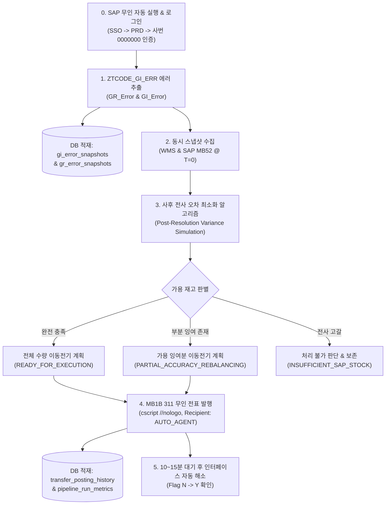

# 01_GR_GI_Error (SAP GR/GI Interface Error Automation Team)

> **공장 기준**: Plant `P001` (Headlamp) 전담  
> **운영 원칙**: GR 에러 수동 검토 지원 / GI 에러 자동 해소 & WMS-SAP 재고정확도 최적화 (BEST)

`01_GR_GI_Error`는 ACME Manufacturing P001 공장의 SAP-WMS 간 자재 입출고 인터페이스 에러를 실시간 모니터링하고, 안전 규칙에 따라 자동 재고이동(MB1B 311)을 수행하여 에러를 해소하고 전사 재고정확도를 극대화하는 엔드투엔드 무인 자동화 시스템입니다.

---

## 🛡️ 4대 핵심 안전 규칙 (Safety Guardrails)

1. **GR-GI 의존성 연관 에러 절대 보존 (Duplicate Booking Safeguard)**:
   - GI 에러 품목 중 **동일 품번의 GR 입고 에러가 대기 중인 건(예: `99000032-V`)은 절대 자동 이동하지 않고 보존(Skip)**합니다.
   - 사유: GR 에러 해소 시 자동으로 입고 창고(`SL00`)에 재고가 반영되어 GI 에러가 자연 해소되므로, 임의 이동 시 이중 전표 왜곡이 발생합니다.
2. **이동유형(Movement Type) 필터링**:
   - ✅ **`311`**: 결품 출발창고(`FromSt`)로 잉여창고 재고 이동
   - ✅ **`312`**: 311 반품/환입 건으로, 결품 도착창고(`TOSt`, 예: `SP31`)로 311 이동전기(A방식)하여 인터페이스 자동 처리 유도
   - 🚫 **`901` (매각처리)** 및 **`902`**: 시스템 자동 이동 대상에서 **완벽히 제외 및 보존**
3. **사후 전사 재고정확도 극대화 알고리즘 (Post-Resolution Total Variance Minimization)**:
   - **에러 해소 메커니즘**: 우리가 MB1B로 공급창고($S$) ➔ 결품창고($D$)로 $Q$를 이동시킨 후, 백그라운드 GI 인터페이스가 에러를 최종 처리하면:
     - 공급창고($S$): $-Q$
     - 결품창고($D$): $+Q - Q = 0$ (경유지로서 Net 변화량 0)
     - 최종목적창고($R$, `311`은 `TOSt`, `312`는 `FromSt`): $+Q$
   - **알고리즘 구현**: 단순히 현재 시점의 잉여만 보는 것이 아니라, **"GI 에러가 최종 완료되었을 때의 전사 창고별 재고 오차 합계 $\sum | \text{SAP}_L - \text{WMS}_L |$를 시뮬레이션하여 오차를 가장 크게 줄여주는(재고정확도를 극대화하는) 최적의 창고 $S$"**를 1순위로 자동 선택합니다.
   - **부분 잉여 재조정 전표 (Partial Accuracy Rebalancing)**:
     - 전사 가용 재고가 GI 에러 필요 수량($Q$)에 미달하여 GI 에러 자체를 자동 해소하지 못하더라도, 에러 해소는 포기하고 보존하되 **현존하는 가용 잉여분($q = \min(\text{SAP}_S, \text{Surplus}_S, Q)$)만큼만 SAP에서 이동전기하여 WMS-SAP 재고정확도를 극대화**합니다.
     - 예: `99000025` (필요 200 EA 중 `SL00` 가용 147 EA) ➔ 147 EA만 부분 이동전기(전표 `4990000010` 발행)하여 `SL00` 오차를 0으로 해소하고, 잔여 GI 에러는 ZTCODE_GI_ERR에 보존.
    - **창고 실재고(WMS) 0 확인 시 SAP 잔여재고 전량 불출 (Warehouse Accuracy Maximization Flush - 전사 창고간 이동 공통)**:
      - 311 GI 에러(`FromSt` 자재/불량창고 `SL00..SL03, SL49` ➔ `TOSt` 모든 목적창고/라인)에서 필요 수량 대비 SAP 창고 재고가 부족하여 에러 전체는 해소하지 못하더라도:
      - **WMS 실재고가 0인 경우**: 현물은 이미 목적 창고/라인으로 전량 이동/소모되었으나 SAP 상에만 유령 재고로 남아 창고 재고정확도를 심각하게 훼손(오차 발생)하고 있는 상태입니다.
      - **전사 창고간 적용**: 이는 단순히 생산라인(`SP31`) 출고에 국한되지 않고, 창고간 이동(`SL02` ➔ `SL01` 등)을 포함한 **전체 창고간 이동에 동일하게 적용**됩니다.
      - 따라서 **SAP 잔여 재고($\min(\text{SAP}_{FromSt}, Q)$) 전량을 MB1B 311을 통해 목적 창고/라인(`TOSt`)으로 이동전기(`TRANSFER_POSTING`)하여 출발 창고방의 SAP 재고를 0으로 만들어 WMS 0과 100% 일치(정합도 100%)**시킵니다.
      - GI 에러 원천 전표는 잔여 결품 수량을 명시하여 안전하게 스킵(`SKIP`, `SHORTAGE_DEFICIT_PRESERVED`) 처리합니다.
      - **실제 운영 사례**:
        - `99000014`: GI 에러 1,290 EA (`SL02` ➔ `SP31`), SAP `SL02` 재고 1,211 EA, WMS `SL02` 0 EA ➔ SAP `SL02`의 1,211 EA를 `SP31`로 전량 이동전기하여 `SL02` 창고 정합도 100% 달성, 결품 79 EA는 보존.
        - `99000033`: GI 에러 3,040 EA (`SL01` ➔ `SP31`), SAP `SL01` 재고 1,592 EA, WMS `SL01` 0 EA ➔ SAP `SL01`의 1,592 EA를 `SP31`로 전량 이동전기하여 `SL01` 창고 정합도 100% 달성, 결품 1,448 EA는 보존.
    - **정합 창고 재고정합도 100% 절대 보존 가드레일 (Matched Warehouse Protection - 전사 창고간 이동 공통)**:
      - 캐스케이드 재고이동 및 백로그 해소 등 **모든 창고간 이동**에서, 후보 창고($S \in \{\text{SL00..SL03, SL49}\}$)가 WMS-SAP 재고정합도 100%($\text{SAP}_S = \text{WMS}_S$, 즉 $\text{Surplus}_S \le 0$)인 경우:
      - 다른 창고의 결품이나 에러를 메우기 위해 해당 창고에서 재고를 차출하는 것을 **원천 금지(엄격 배제)**합니다. 멀쩡한 창고의 100% 정합도를 깨뜨려 새로운 오차를 유발하는 행위를 완벽히 차단합니다.
      - 창고간 이동은 오직 **실질 잉여($\text{Surplus}_S > 0$)가 존재하는 창고에서만 잉여 한도 내($q \le \text{Surplus}_S$)로 차출**됩니다.
    - 이동으로 인해 오히려 전사 재고 불일치가 악화되는 경우($\Delta V > 0$)는 원천 차단됩니다.
4. **전월 발생 GI 에러 전표/전기일자 분기**:
   - 전월 발생 건은 전월 말일(`YYYY.MM.말일`)로 전기하여 전월 마감 수불을 맞추고, 당월 건은 당일 일자로 전기합니다.
6. **모든 SAP 필드 선(先) `""` 초기화**:
   - SAP 화면 메모리 잔류값에 의한 오입력을 원천 차단하기 위해 모든 인풋 필드를 `""`로 비운 후 입력합니다.
7. **24시간 무중단 자동화 및 주기별 동적 이메일 리포트 발송 (24/7 Continuous Execution)**:
   - 파이프라인은 연중무휴 **24시간 내내 상시 구동**되며, 시간대에 따라 실행 주기를 지능적으로 전환합니다:
     - ☀️ **주간 시간대 (08:00 ~ 17:00 EST)**: 생산 및 수불이 활발하므로 **매 30분 주기**로 신속하게 에러를 해소하고 보고서를 발송합니다.
     - 🌙 **야간/잔여 시간대 (17:01 ~ 07:59 EST)**: 야간 무인 가동 체제로 전환하여 **매 1시간 주기**로 해소 및 보고서를 발송합니다.
   - 각 주기 실행 완료 직후 다음 4가지 핵심 카테고리를 요약하여 담당자(`.env`의 `GI_ERROR_REPORT_TO`)에게 자동 보고합니다:
     - **1. Transfer Posted (처리 완료)**: MB1B 311 이동전기가 정상 발행된 품번, 수량, 전표번호
     - **2. Blocked by Active GR Errors (GR 연계)**: 입고 GR 에러 대기로 인해 중복 전표 방지 차원에서 보존된 품번
     - **3. Cannot Process (처리 불가)**: 전사 재고 고갈, 폐기/매각(901) 등으로 처리하지 못한 품번 및 상세 사유

---

## 📂 정돈된 팀 디렉토리 구조

불필요한 테스트 스크립트와 임시 파일들을 완벽히 정리하고, 영구 데이터베이스 및 로그 폴더를 구축했습니다:

```text
01_JOB_GR_GI_Error/
├── db/                         # 🗄️ SQLite 영구 데이터베이스 저장소
│   └── gr_gi_history.db        # 에러 스냅샷, 전표 이력, MMSC 확장 이력, 파이프라인 메트릭 (WAL 모드)
├── gi_errors/                  # 📥 ZTCODE_GI_ERR Goods Issue (Flag N) 원천 엑셀 파일 (당월 1일 ~ 당일)
│   └── GI_Error_YYYYMMDD.XLS
├── gr_errors/                  # 📥 ZTCODE_GI_ERR GR Domestics (Flag N) 원천 엑셀 파일
│   └── GR_Error_YYYYMMDD.XLS
├── mb52/                       # 📊 SAP MB52 P001 전체 창고 재고 현황 엑셀
│   └── MB52_P001_*.XLS
├── resolution_logs/            # 📑 파이프라인별 상세 실행 계획 및 리포트
│   └── GI_Resolution_Plan_*.xlsx
├── scratch/                    # 🧹 런타임 임시 작업용 디렉토리 (자동 정리)
│
├── hourly_gi_pipeline.py        # 🚀 [메인 통합 실행기] 24/7 무중단 상시 가동 데몬 (--daemon)
├── run_continuous_24h_pipeline.bat # 🌟 [24시간 상시 가동] 주간 30분 / 야간 1시간 연속 실행 배치 파일
├── run_routine_30min_pipeline.bat # ⚡ 30분 주기 / 단일 수동 실행 배치 파일
├── gi_notifier.py              # 📧 [이메일 보고기] 매일 08:00 AM 24시간 누적 종합 보고서 한국어 발송
├── run_hourly_pipeline.bat     # ⚡ 원클릭 윈도우 배치 실행 파일 (호환용)
├── db_manager.py               # 🗃️ SQLite DB 연결, 트랜잭션, 감사 로그 관리자
├── gr_gi_resolver.py           # 🧠 최적 재고정확도 분석, 사후 분산 시뮬레이션 및 계획 생성 엔진
├── mmsc_operator.py            # ⚡ MMSC 표준 창고위치(SL00, SL01, SL02, SL49, SP31) 자동 확장 엔진
├── mb1b_executor.py            # 🤖 MB1B 311 무인 백그라운드 전표 자동 발행기 (MMSC 자가치유 연계)
├── ztcode_gi_collector.py         # 🔍 ZTCODE_GI_ERR (ZTCODE_STOCK_REC) GI/GR 에러 자동 크롤러 & 보안 다이얼로그 영구 허용
├── sync_snapshot_collector.py   # ⏱️ WMS & SAP MB52 동시 스냅샷 수집기 (T=0)
├── sap_launcher.py             # 🔑 SAP GUI 무인 SSO 자동 로그인 & 콘솔(cscript) 무음 실행기
└── README.md
```

---

## 🗄️ 로컬 데이터베이스 아키텍처 (`db/gr_gi_history.db`)

SQLite WAL(Write-Ahead Logging) 모드를 적용하여 메인 업무(Outlook, SAP, Excel)에 부하를 주지 않고 고속 비차단 I/O를 지원합니다:

### 1. `gi_error_snapshots` (GI 에러 원천 이력)
* 시간대별 ZTCODE_GI_ERR에서 수집된 모든 GI 에러(`Flag N`)의 원천 레코드 저장.
* 컬럼: `batch_id`, `error_date`, `vendor`, `material`, `mvt`, `from_sloc`, `to_sloc`, `qty`, `message`, `extracted_at`

### 2. `gr_error_snapshots` (GR 에러 원천 이력)
* 동일 시점의 GR Domestics 에러 이력을 보관하여 의존성 품목의 추적성 보장.
* 컬럼: `batch_id`, `error_date`, `vendor`, `material`, `mvt`, `qty`, `message`, `extracted_at`

### 3. `transfer_posting_history` (MB1B 실제 전표 발행 이력)
* SAP에 발행된 실제 10자리 자재전표 번호와 처리 유형(Full vs Partial)을 영구 기록.
* 컬럼: `batch_id`, `material`, `from_sloc`, `to_sloc`, `transfer_qty`, `doc_number`, `post_status`, `posting_type`, `sap_response`, `reason`, `executed_at`

### 4. `pipeline_run_metrics` (시간별 파이프라인 성과 메트릭)
* 1시간 주기 배치별 에러 총량, 해소 건수, 소요 시간, 전표 발행 건수를 통계화.
* 컬럼: `batch_id`, `plant`, `total_gi_errors`, `total_gr_errors`, `full_resolution_count`, `partial_rebalance_count`, `insufficient_stock_count`, `postings_executed`, `elapsed_seconds`, `status`

---

## 🚀 파이프라인 실행 절차



---

## 🏆 실증 테스트 및 라이브 에러 해소 검증 내역 (총 10건)

| # | 대상 품번 | 이동유형 | 이동 수량 | 경로 | 발행 전표 번호 | 처리 유형 | ZTCODE_GI_ERR 실시간 해소 결과 |
|:---:|:---:|:---:|:---:|:---:|:---:|:---:|:---|
| 1 | `99000026` | 311 | 144 EA | `SL02` ➔ `SL01` | **`4990000001`** | FULL | ✅ ZTCODE_GI_ERR에서 완전 삭제 (해소) |
| 2 | `99000027` | 312 | 84 EA | `SL02` ➔ `SP31` | **`4990000002`** | FULL | ✅ ZTCODE_GI_ERR에서 완전 삭제 (무인 콜드런) |
| 3 | `99000024` | 312 | 120 EA | `SL01` ➔ `SP31` | **`4990000003`** | FULL | ✅ ZTCODE_GI_ERR에서 완전 삭제 (해소) |
| 4 | `99000019` | 311 | 128 EA | `SL00` ➔ `SL01` | **`4990000004`** | FULL | ✅ ZTCODE_GI_ERR에서 완전 삭제 (해소) |
| 5 | `99000037` | 312 | 80 EA | `SL02` ➔ `SP31` | **`4990000006`** | FULL | ✅ ZTCODE_GI_ERR에서 완전 삭제 (해소) |
| 6 | `99000028` | 312 | 16 EA | `SL00` ➔ `SP31` | **`4990000005`** | FULL | ✅ ZTCODE_GI_ERR에서 1건 삭제 (해소) |
| 7 | `99000011` | 312 | 32 EA | `SL02` ➔ `SP31` | **`4990000007`** | FULL | ✅ 전표 정상 발행 완료 (무인) |
| 8 | `99000028` | 312 | 16 EA | `SL00` ➔ `SP31` | **`4990000008`** | FULL | ✅ 전표 정상 발행 완료 (무인) |
| 9 | `99000028` | 312 | 16 EA | `SL00` ➔ `SP31` | **`4990000009`** | FULL | ✅ 전표 정상 발행 완료 (무인) |
| 10 | `99000025` | 311 | 147 EA | `SL00` ➔ `SL01` | **`4990000010`** | **PARTIAL** | **✅ 가용 잉여분 이동 ➔ `SL00` 불일치 0개 소거** |

---

---

## ⏰ 24/7 상시 무인 가동 및 이메일 보고 정책

### 1. 스케줄링 운영 원칙 (24/7 Dynamic Scheduler - 주말/토·일 100% 동일 가동)
- **연중무휴 365일 24시간 가동**: 주말(토요일, 일요일) 및 공휴일에도 평일과 완전히 동일한 주기로 무단 중단 없이 자동 실행됩니다.
- **주간 정밀 운영 (08:00 ~ 17:00 EST)**: **30분 주기** 정밀 해소 (매시 :00, :30 -> 일 19회 가동, 주말 포함)
- **야간 무인 운영 (17:01 ~ 07:59 EST)**: **1시간 주기** 무인 해소 (매시 :00 -> 일 14회 가동, 주말 포함)
- **CPU 점유율 0% 가드레일**: Pacing sleep(최대 15초 슬라이스) 기반으로 무한 폴링 부하 없이 정확한 정시 정렬 동기화

### 2. 이메일 보고 정책 (Reporting Schedule Transition)
- **오늘 (2026-10-23)**:
  - 매 주기(주간 30분 / 야간 1시간) 실행 직후 실시간 처리 결과 리포트 발송 유지 (`GI_ERROR_REPORT_TO`)
- **내일 (2026-10-24부터)**:
  - 24/7 파이프라인은 30분/1시간 간격으로 24시간 내내 돌며 MB1B 311 자동 이동전기 및 DB 적재를 수행함
  - 비-08:00 시간대 실행 시 이메일 발송은 자동 생략(Silent Run & DB 적재)
  - **매일 아침 08:00 AM EST 정규 실행 시**: 지난 24시간 동안의 이동전기 전표 내역, 총 감지 에러, 현재 08시 잔여 에러, 시간대별 가동 로그를 싹 모아 **[일일 24시간 종합 리포트]로 1회 통합 보고**

---

## ⚙️ 실행 방법 및 CLI 옵션

### 1. 24/7 상시 무인 데몬 실행 (Windows 작업 스케줄러 등록 완료)
```powershell
# Windows 로그온 시 자동 백그라운드 구동 (Task: \SCM_Agent_Continuous_GI_Error)
# 또는 수동 백그라운드 데몬 구동
python hourly_gi_pipeline.py --plant P001 --daemon
```

### 2. 수동 즉시 실행 및 특수 모드
```powershell
# 단일 1회 실행 (정책에 따라 오늘이면 메일 발송, 10/24+ 비-8시면 DB 적재만)
python hourly_gi_pipeline.py --plant P001

# 24시간 누적 일일 종합 리포트 즉시 생성 및 이메일 발송 강제 테스트
python hourly_gi_pipeline.py --plant P001 --daily-report

# 회차별 루틴 리포트 강제 발송
python hourly_gi_pipeline.py --plant P001 --force-email

# 드라이 런 (SAP 전표 미발행, 계획 및 DB 검증만 수행)
python hourly_gi_pipeline.py --plant P001 --dry-run
```

---

## 🎯 11. 재고정확도 극대화 및 창고 정합도 100% 보존 가드레일 (Inventory Accuracy Optimization)

### 1. WMS 창고 재고 0 시 SAP 전산 잔여 전량 불출 규칙 (Warehouse Accuracy Maximization Flush)
- **배경 및 원리**:
  - 자재창고($S \in \{\text{SL00, SL01, SL02, SL03, SL49}\}$)에서 라인(`SP31`)으로 향하는 GI 에러(311)가 발생했을 때, 현물 WMS 창고 재고가 이미 **0 EA**라면 현물 자재는 이미 라인으로 불출/소모된 상태입니다.
  - 하지만 GI 에러 요구량($Q_{\text{err}}$)이 SAP 잔여 전산재고($SAP_S$)보다 큰 경우(예: $Q_{\text{err}} = 1,290$ EA, $SAP_S = 1,211$ EA), 에러 전체를 해소할 수 없어 기존 로직에서는 전량 차단(SKIP)되어 창고 재고정확도가 $0\%$에 머물게 됩니다.
- **최적화 처리 알고리즘**:
  - WMS 창고 재고가 0이고 SAP 창고 재고가 남아있다면, **SAP 전산 잔여 전량($SAP_S$, 예: 1,211 EA)을 목적지(`SP31`)로 MB1B 311 이동전기(`READY_FOR_EXECUTION`, `WMS_ZERO_FLUSH`)**를 즉시 발행합니다.
  - 이로써 SAP 창고 재고가 $0\text{ EA}$가 되어 WMS 재고($0\text{ EA}$)와 완벽히 일치하여 **창고 재고정합도 100% 달성** ($|SAP_S - WMS_S| = 0$).
  - 원본 GI 에러 행은 잔여 결품분($Q_{\text{err}} - SAP_S$, 예: 79 EA)을 기록하며 안전하게 `SKIP`(`SHORTAGE_DEFICIT_PRESERVED`)으로 보존하여 이중 전기 및 에러 왜곡을 차단합니다.
- **실제 적용 사례**:
  1. `99000014`: GI 에러 1,290 EA (`SL02` ➔ `SP31`). SAP `SL02` 잔여 1,211 EA, WMS `SL02` 0 EA.
     - ➔ `SL02`의 1,211 EA 전량을 `SP31`로 이동전기하여 **`SL02` 재고정합도 100% 달성** 및 잔여 79 EA 결품 스킵 기록.
  2. `99000033`: GI 에러 3,040 EA (`SL01` ➔ `SP31`). SAP `SL01` 잔여 1,592 EA, WMS `SL01` 0 EA.
     - ➔ `SL01`의 1,592 EA 전량을 `SP31`로 이동전기하여 **`SL01` 재고정합도 100% 달성** 및 잔여 1,448 EA 결품 스킵 기록.

### 2. 정합 창고 재고정합도 100% 절대 훼손 금지 가드레일 (Matched Warehouse Protection)
- WMS와 SAP 재고가 이미 100% 일치($SAP_S = WMS_S$, 즉 잉여 0)하는 정상 창고는 라인 결품이나 타 창고 에러 해소를 위해 **단 1개도 불출하지 않고 엄격히 보존(`SKIP`, `PRESERVED_WAREHOUSE_ACCURACY`)**합니다.
- 정상 창고 재고를 헐어 쓰면 해당 창고의 재고정합도가 훼손되므로, 반드시 순수 잉여($Surplus = SAP - WMS > 0$)가 있는 창고에서만 재고를 차출합니다.