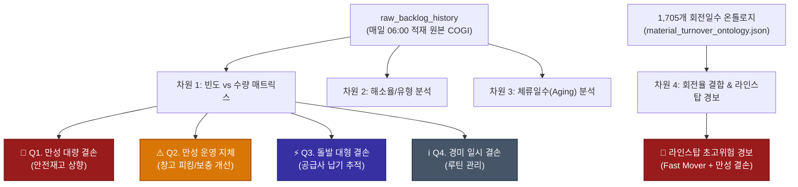

# 03_Backlog_Analysis (생산 백로그 시계열 심층 분석팀)

`03_Backlog_Analysis`는 `02_Backlog_Clear`가 매일 아침 06:00에 SAP COGI 리프레시 후 데이터베이스(`raw_backlog_history`)에 영구 적재하는 원본 백로그 빅데이터를 기반으로, **주간/월간 단위로 만성 결손 품목의 패턴, 공급망 병목 지점, 창고-라인 보충 지체 및 라인스탑 위험도를 다차원(4대 분석 차원)으로 진단하는 전문 분석 엔진**입니다.

---

## 🏛️ 역할 분담 (R&R): `02_Backlog_Clear` vs `03_Backlog_Analysis`

| 구분 | `02_Backlog_Clear` (현장 실행팀) | `03_Backlog_Analysis` (전략 분석팀) |
| :--- | :--- | :--- |
| **핵심 미션** | **당일 발생 백로그 실시간 해소(Clear)** | **주간/월간 누적 백로그 원인 진단 및 체질 개선** |
| **가동 주기** | 매일 06:20 (1차 사전해소) / 08:15 (2차 본해소) | 주간 / 월간 정기 분석 (1차 마일스톤: **2026-10-31**) |
| **주요 작업** | • SAP COGI 실시간 SAVE & 리프레시 동기화<br>• 원본 백로그(`raw_backlog_history`) 영구 적재<br>• MB1B 311 자동 이동전기 전표 실시간 발행<br>• 자재 플래너 조치 요청 메일 일일 발송 | • 4대 분석 차원 시계열 진단 엔진 구동<br>• 1,705개 품번 회전일수 온톨로지 결합 분석<br>• 4분면(Quadrant) 매트릭스 분류 및 병목 추출<br>• 다분할 심층 엑셀/HTML 종합 분석 보고서 발행 |
| **산출물** | 일일 전표 번호(499...), 일일 해소 결과 메일 | `Backlog_Deep_Analysis_YYYYMMDD.xlsx` (4개 시트) |

---

## 🧭 4대 핵심 분석 차원 (4-Dimensional Analytics Framework)



### 1. 차원 1: 빈도(Frequency) vs 수량(Volume) 4분면 매트릭스
* **🚨 Q1. 만성 대량 결손 (Chronic & Massive)**:
  * 정의: 발생 빈도 $\ge 40\%$ (또는 $\ge 3$일) & 누적 결손 상위 25% (대량 결손).
  * 진단: 공장 생산 차질 및 라인 스탑을 유발하는 최우선 고위험 병목 품목.
  * 조치: **안전재고(Safety Stock) 상향 + 구매/입고 주기 단축 긴급 건의**.
* **⚠️ Q2. 만성 운영 지체 (Chronic Operational Delay)**:
  * 정의: 발생 빈도 $\ge 40\%$ & 소량 결손.
  * 진단: 자재는 있으나 창고(SL01)에서 라인(SP31)으로의 불출/보충 주기가 늦어 매일 찍히는 운영 지연.
  * 조치: **창고-현장 자동보충(Min-Max) 라인 피킹 품목 전환 및 대차 동선 개선**.
* **⚡ Q3. 돌발 대형 결손 (Critical Surge)**:
  * 정의: 발생 빈도 $< 40\%$ & 일시적 대량 결손.
  * 진단: 평소엔 없다가 특정일에 터지는 공급사 납기 지연, 입고 불량(HOLD), 선적 누락.
  * 조치: **공급사 납기(ETA) 및 선적 품질 집중 추적**.
* **ℹ️ Q4. 경미 일시 결손 (Minor Infrequent)**:
  * 정의: 저빈도 & 소량 결손.
  * 조치: 일일 06/08시 자동 이동전기 루틴 유지.

### 2. 차원 2: 백로그 해소 패턴 (가짜 백로그 vs 진짜 결품)
* **MB1B 311 창고 잉여 해소율**:
  * 창고(SL01 등) 재고로 즉시 풀린 수량 비율. 이 비율이 높을수록 실물은 충분한데 라인 이동만 누락된 **"가짜 백로그"**임을 증명.
* **진짜 결품 (True Shortage)**:
  * 공장 전체(P001)에 재고가 0인 순수 공급 부족 품목 식별.

### 3. 차원 3: 체류일수(Aging) 및 만성도 분석
* 생산일(`entry_date`) 대비 현재 일자 간의 체류 갭 분석:
  * `0~1일 (당일/익일 즉시 해소)` / `2~3일 (단기)` / `4~7일 (중기)` / `> 7일 (만성 장기 체류)`.
  * 장기 체류 품목의 공급사/부품군 편중도 파악.

### 4. 차원 4: 1,705개 회전일수 온톨로지 결합 (`00_StockAccuracy` 연계)
* `material_turnover_ontology.json`과 실시간 조인하여 `FAST_MOVER`, `NORMAL`, `SLOW_MOVER` 매핑.
* **🛑 라인스탑 초고위험(Line-Stop Critical Hazard)**:
  * **회전율이 극도로 빠른 Fast Mover가 Q1(만성 대량) 또는 Q2(만성 지체)에 속하는 경우**, 시스템이 즉시 적색 경보를 발령하여 라인 정지를 사전 예방합니다.

---

## 📅 운영 마일스톤 및 일정 (Milestone Schedule)

* **정기 가동 주기**: **매주 금요일 08:30 AM EST** (Windows Task Scheduler: `SCM_Agent_Weekly_Backlog_Analysis`)
* **당일 데이터 실시간 반영 가드레일 (`ensure_today_backlog_accumulated`)**:
  * 주간 분석 실행 당일의 **06:20 AM (1차) 및 08:15 AM (2차) 백로그 해소 실적이 누적 반영된 직후(08:30 AM)**에 가동됩니다.
  * 분석 스크립트 실행 시 당일의 백로그 처리 완료 여부를 SQLite DB에서 사전 자동 점검합니다. (D66 원칙: 당일 데이터가 미처리 상태여도 `02_JOB_Backlog_Clear`를 대리 실행하지 않으며, 가용 데이터 기반으로 분석을 진행하고 보고서 상단에 미반영 안내 배너를 표기합니다.)
* **1차 월말 마일스톤**: **2026-10-31 (월말 심층 종합 분석)**
* **수신처**: `.env`의 `BACKLOG_ANALYSIS_TO` 참조 (초기 고도화 단계: 담당자 전담 수신)

---

## 💻 실행 및 분석 명령어 가이드

```powershell
# 1. 터미널 요약 및 다분할 엑셀/마크다운 보고서 자동 생성
python 01_DEPT_Inventory/03_JOB_Backlog_Analysis/run_analysis.py --preview

# 2. 분석 완료 후 Outlook 메일 자동 발송 (사용자 전용 수신)
python 01_DEPT_Inventory/03_JOB_Backlog_Analysis/run_analysis.py --email

# 3. 특정 분석 기간 지정 실행
python 01_DEPT_Inventory/03_JOB_Backlog_Analysis/run_analysis.py --start-date 2026-10-23 --end-date 2026-10-31 --email

# 4. 배치 런처 실행
01_DEPT_Inventory\03_JOB_Backlog_Analysis\run_analysis.bat --preview
```

---

## 📊 산출물 구조

* **엑셀 심층 분석 리포트 (`reports/Backlog_Deep_Analysis_YYYYMMDD_HHMMSS.xlsx`)**:
  * Tab 1: `Executive_Summary` (KPI 카드, 4분면 매트릭스 집계, 라인스탑 고위험 경보)
  * Tab 2: `4_Quadrant_Matrix` (전체 품목 상세, 온톨로지, 현장 권고사항)
  * Tab 3: `Top10_Bottlenecks` (최다 빈도 Top10, 최대 수량 Top10, 최장 체류 Top10)
* **마크다운 리포트 (`reports/Backlog_Deep_Analysis_YYYYMMDD.md`)**:
  * `00_TaskManager`의 일일/주간 브리핑에 즉시 임베딩 가능한 요약 마크다운.
