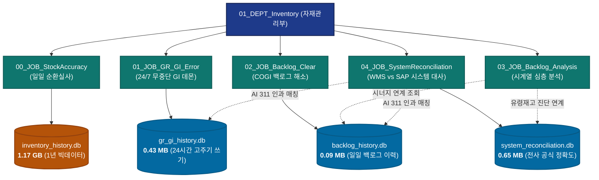

# 01_DEPT_Inventory 전사 데이터베이스 아키텍처 및 통합 스키마 명세서
> **문서 버전**: `v1.2` | **최종 갱신**: `2026-10-25` | **관리 부서**: `01_DEPT_Inventory` (자재/재고 부서 본부)

---

## 🏛️ 1. 데이터베이스 분리 vs 통합 아키텍처 결정 (Architectural Decision)

### 📌 결론: **"물리적 분리(Separated Physical DB) + 논리적 연계(Python API & SQLite ATTACH)" 원칙 유지**

`01_DEPT_Inventory` 산하의 여러 단위 작업(Job)에서 생성되는 SQLite DB들은 **물리적으로 분리하여 관리하는 것이 압도적으로 우수하며 안전**합니다.



---

### 🔍 왜 하나로 합치면 안 되는가? (물리적 분리가 필수적인 4대 이유)

#### 1. SQLite 파일 락(Lock Contention) 및 동시성 충돌 원천 차단
- SQLite는 파일 기반 RDBMS이므로 **동일 DB 파일에 대해 단 1개의 프로세스만 쓰기(Single Writer)**가 가능합니다.
- 특히 `01_JOB_GR_GI_Error`는 **24시간 내내 30분~1시간 주기로 백그라운드에서 상시 쓰기**를 수행합니다.
- 만약 모든 Job의 테이블을 단일 `inventory_master.db`로 합쳐버리면, 01_JOB이 쓰기 트랜잭션을 쥐고 있는 동안 00_JOB(1.17GB 연간 적재), 02_JOB(COGI 적재), 04_JOB(1,935행 일괄 INSERT)이 동시에 접근할 때 Windows OS 상에서 **`sqlite3.OperationalError: database is locked`**가 발생하여 파이프라인이 멈추게 됩니다.
- **물리적으로 분리하면 각 Job이 전용 파일에 독립적으로 접근하므로 락 경쟁이 0%로 완벽히 차단**됩니다.

#### 2. 1.17GB 대용량 DB I/O 부하 격리
- `00_JOB_StockAccuracy`의 `inventory_history.db`는 1년치 WMS 입출고 빅데이터(269만 행)로 인해 이미 **1.17 GB** 크기입니다.
- 가벼운 수십 KB~수백 KB 단위의 01_JOB, 02_JOB, 04_JOB이 1.17GB 대형 파일의 핸들을 열고 닫아야 한다면 디스크 I/O와 백업 부하가 불필요하게 가중됩니다.

#### 3. 장애 격리 (Fault Isolation & Independent Recovery)
- 특정 작업(Job)에서 프로세스가 비정상 종료되거나 파일 락 오류가 발생하더라도, 해당 단위 작업의 DB 파일만 격리되며 다른 핵심 업무(순환실사, 백로그 등)에는 일절 영향을 주지 않습니다.
- 백업 및 롤백도 파일 단위로 즉각 수행할 수 있습니다.

#### 4. 크로스 조인이 필요할 때의 유연성: SQLite `ATTACH DATABASE` 지원
- 물리적으로 분리되어 있어도 다른 DB의 데이터와 조인(`JOIN`)해야 할 경우, SQLite의 표준 기능인 `ATTACH DATABASE`를 사용하면 단일 SQL 세션에서 여러 DB 파일의 테이블을 자유롭게 교차 쿼리할 수 있습니다.
  ```sql
  -- 예시: 04_JOB에서 01_JOB의 이동전기 전표와 04_JOB의 불일치 품목을 한 번에 조인
  ATTACH DATABASE '01_DEPT_Inventory/01_JOB_GR_GI_Error/db/gr_gi_history.db' AS gi_db;
  SELECT a.material, a.diff_qty, b.doc_number, b.transfer_qty
  FROM accuracy_material_snapshot a
  LEFT JOIN gi_db.transfer_posting_history b ON a.material = b.material;
  ```

---

## 🗄️ 2. 전사 4대 데이터베이스 현황 요약 (Databases Summary)

| 데이터베이스 | 전담 Job | 파일 경로 | 파일 크기 | WAL 모드 | 주요 역할 및 적재 주기 |
| :--- | :--- | :--- | :---: | :---: | :--- |
| **`inventory_history.db`** | `00_JOB_StockAccuracy` | `00_JOB_StockAccuracy/db/inventory_history.db` | **1,170.2 MB** | 적용 | WMS 1년치 입출고(269만건) 빅데이터, 회전일수 온톨로지, 순환실사 40 Bins 산출 (매일 04:00 AM) |
| **`gr_gi_history.db`** | `01_JOB_GR_GI_Error` | `01_JOB_GR_GI_Error/db/gr_gi_history.db` | **0.43 MB** | 적용 | ZTCODE_GI_ERR GI/GR 인터페이스 에러 스냅샷, MB1B 311 전표 발행 이력 (24/7 상시 30m~1h) |
| **`backlog_history.db`** | `02_JOB_Backlog_Clear` | `02_JOB_Backlog_Clear/db/backlog_history.db` | **0.09 MB** | 적용 | COGI 생산 백로그 실시간 스냅샷, 06:10/08:15 누적 성과 지표, 06:00 초기 원본 아카이브 |
| **`system_reconciliation.db`** | `04_JOB_SystemReconciliation` | `04_JOB_SystemReconciliation/db/system_reconciliation.db` | **0.65 MB** | 적용 | 전사 공식 재고정확도([MM] Stock Accuracy, 96.56%), 1,935개 품목 스냅샷, 만성 유령재고 추적 |

---

## 📋 3. 전사 테이블 상세 스키마 명세서 (Full Schema Reference)

### [DB 1] `inventory_history.db` (00_JOB_StockAccuracy)
- **위치**: `00_JOB_StockAccuracy/db/inventory_history.db`
- **테이블 목록**:
  1. **`GR_TRANSACTIONS`** (841,457건):
     - `TRANSACTION_ID`, `TRANSACTION_DATE`, `ITEM_CD`, `ITEM_NM`, `QTY`, `FROM_LOC`, `TO_LOC`, `BARCODE`, `CREATED_TIME`
  2. **`GI_TRANSACTIONS`** (1,848,798건):
     - `TRANSACTION_ID`, `TRANSACTION_DATE`, `ITEM_CD`, `ITEM_NM`, `QTY`, `FROM_LOC`, `TO_LOC`, `BARCODE`, `CREATED_TIME`
  3. **`BARCODE_LIFECYCLE`** (875,374건):
     - `BARCODE`, `ITEM_CD`, `GR_DATE`, `GI_DATE`, `STAY_DAYS`, `STATUS`
  4. **`MATERIAL_ONTOLOGY`** (1,705건):
     - `ITEM_CD`, `ITEM_NM`, `TRIMMED_MEAN_DAYS`, `STD_DAYS`, `MEDIAN_DAYS`, `MOVER_CLASS`, `LAST_UPDATED`
  5. **`BARCODE_BIN_STAY`** (61,395건):
     - 바코드별 Bin 체류 일수 및 Aging 지표
  6. **`MISSING_GI_SNAPSHOT` / `MISSING_GI_BASELINE`** (2,835건):
     - 미입고 출고(Orphan) 품목 관리 테이블
  7. **`AUDIT_RUN`** (실사 회차 원장):
     - `run_id` (PK), `run_date`, `mode` (Daily/Weekly), `scoring_version`, `wms_snapshot_file`, `config_hash`, `created_at`
  8. **`AUDIT_ASSIGNMENT`** (지시 원장, 40+3 Bins):
     - `assignment_id` (PK), `run_id`, `bin`, `list_type` (TOP/EXTENDED/RANDOM/CHRONIC_FEED), `rank`, `bin_risk_score`, `selection_method`, `action_required`, `primary_reason`, `label_qty`, `inclusion_probability`
  9. **`AUDIT_FEATURE_SNAPSHOT`** (시점 피처 스냅샷):
     - `snapshot_id` (PK), `assignment_id`, `run_id`, `barcode`, `mat_no`, `p_error_proxy`, `net_price`, `expected_loss`, `est_minutes`, `priority_ev`, `ztcode_stock_rec_exposure`, `ztcode_stock_rec_consecutive_days`
  10. **`AUDIT_RESULT`** (현장 실물 검증 Ground Truth):
      - `result_id` (PK), `assignment_id` (FK), `run_id`, `bin`, `counted_qty`, `book_qty_at_count`, `diff_qty`, `diff_amount`, `cause_code`, `in_flight_adjusted`, `is_confirmed`, `audit_origin`
  11. **`WMS_STOCK_DAILY_AGG`** (Bin x Mat 일일 압축 집계):
      - `agg_id` (PK), `snapshot_date`, `bin`, `mat_no`, `box_count`, `total_qty`

---

### [DB 2] `gr_gi_history.db` (01_JOB_GR_GI_Error)
- **위치**: `01_JOB_GR_GI_Error/db/gr_gi_history.db`
- **테이블 목록**:
  1. **`transfer_posting_history`**:
     - `id` (PK), `batch_id`, `executed_at`, `material`, `from_sloc`, `to_sloc`, `transfer_qty`, `mb1b_mvt`, `doc_number`, `post_status`, `posting_type`, `sap_response`, `reason`
     - *주요 상태*: `POSTED`(전표발행 성공), `FAILED_DEFICIT`(가용재고 부족), `FAILED_ERROR`(GUI/통신 오류)
  2. **`gi_error_snapshots`**:
     - `id` (PK), `batch_id`, `snapshot_time`, `material`, `material_desc`, `mvt`, `deficit_sloc`, `error_qty`, `status`, `reason`
  3. **`gr_error_snapshots`**:
     - `id` (PK), `batch_id`, `snapshot_time`, `material`, `material_desc`, `mvt`, `sloc`, `error_qty`, `gr_flag`
  4. **`pipeline_run_metrics`**:
     - `id` (PK), `batch_id`, `run_time`, `total_gi_errors`, `total_gr_errors`, `postings_executed`, `elapsed_seconds`, `status`
  5. **`gi_email_sent_log`**:
     - 일일 08:00 AM 종합 리포트 발송 이력
  6. **`mmsc_extension_history`**:
     - SAP MMSC 저장위치 자동 확장(Auto-Heal) 이력

---

### [DB 3] `backlog_history.db` (02_JOB_Backlog_Clear)
- **위치**: `02_JOB_Backlog_Clear/db/backlog_history.db`
- **테이블 목록**:
  1. **`cogi_snapshots`**:
     - `id` (PK), `batch_id`, `snapshot_time`, `material`, `material_desc`, `error_qty`, `prod_order`, `sloc`
  2. **`backlog_transfers`**:
     - `id` (PK), `batch_id`, `run_date`, `run_time`, `material`, `from_sloc`, `to_sloc`, `transfer_qty`, `doc_number`, `status`, `result_msg`
  3. **`daily_backlog_metrics`**:
     - `id` (PK), `run_date`, `run_time`, `total_backlog_count`, `total_backlog_qty`, `resolved_count`, `resolved_qty`, `remaining_count`, `remaining_qty`, `transfers_count`
  4. **`raw_backlog_history`**:
     - 매일 아침 06:00 1차 가동 시 추출한 COGI 초기 원본 데이터 보존 (03_JOB 분석 엔진의 시계열 원천)

---

### [DB 4] `system_reconciliation.db` (04_JOB_SystemReconciliation)
- **위치**: `04_JOB_SystemReconciliation/db/system_reconciliation.db`
- **테이블 목록**:
  1. **`accuracy_daily_summary`**:
     - `id` (PK), `snapshot_date`, `posting_date`, `plant`, `system_group`, `total_items`, `matched_items`, `mismatched_items`, `accuracy_rate` (완전일치율), `avg_score` (공식 MM정확도, 96.56%), `total_diff_qty`, `total_financial_exposure`, `dod_accuracy_delta`, `captured_at`
  2. **`accuracy_material_snapshot`**:
     - `id` (PK), `snapshot_date`, `posting_date`, `material`, `description`, `wms_lgort`, `sap_lgort`, `wms_qty`, `sap_qty`, `diff_qty`, `score`, `net_price`, `financial_exposure`
  3. **`chronic_mismatch_registry`**:
     - 3일 이상 지속되는 만성 유령재고(Ghost Inventory) 등록부
     - `material`, `consecutive_days`, `current_diff_qty`, `current_financial_exposure`, `status`, `recommended_for_audit` (00_JOB 실사 추천 플래그)
  4. **`ai_attribution_log`**:
     - AI 자동화(MB1B 311) 전표의 익일 ZTCODE_STOCK_REC 정확도 상승 기여도(Accuracy Lift, +%p) 및 인과적 ROI 증명 로그

---

## 🔄 4. 데이터 보존 및 디스크 수명주기 정책 (Data Retention & Pruning)

1. **SQLite DB 파일 (`*.db`)**:
   - **영구 보존 (Permanent Retention)**: 모든 분석과 감사의 기준이 되므로 자동 삭제 대상에서 영구 제외됩니다.
2. **원천 엑셀 및 텍스트 덤프 (`*.xlsx`, `*.xls`, `*.csv`, `*.txt`)**:
   - **7일 보존 후 자동 삭제**: `storage_retention.py`에 의해 7일이 지난 만료 파일은 매일 자동 삭제되어 디스크 공간을 회수합니다.
3. **대표 최신 파일 (`*_latest.*`)**:
   - 일상 업무 및 타 스크립트 참조를 위해 **덮어쓰기 방식으로 영구 보존 보호**됩니다.
4. **임시 스크래치 파일 (`scratch/*.vbs`, `scratch/*.txt`)**:
   - **24시간 경과 후 자동 파기**됩니다.

---

## 🌐 5. 전사 다부서(Multi-DEPT) 데이터 온톨로지 연계
타 부서(`02_DEPT_Invoice_Settlement`, `03_DEPT_EDI_OrderSync`, `04_DEPT_Logistics_Receiving`, `05_DEPT_Program_MasterData`)와의 전사 차원 데이터 지식그래프 및 결합 프로토콜은 **[ENTERPRISE_DATA_ONTOLOGY.md](file:///%USERPROFILE%/Workspace/manufacturing-agent-org/01_M365MCP/ENTERPRISE_DATA_ONTOLOGY.md)**에 표준화되어 있습니다.
