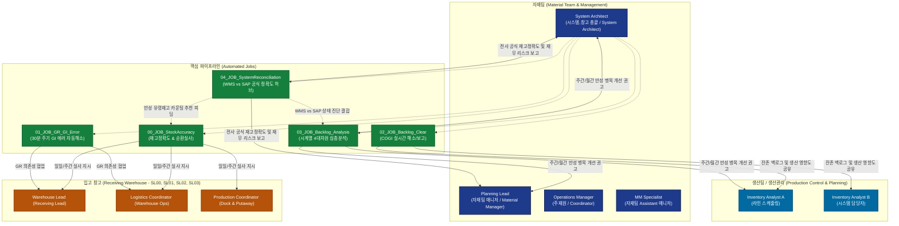

# 01_DEPT_Inventory (재고 및 자재 관리 부서)

`01_DEPT_Inventory`는 ACME Manufacturing (Plant P001 Headlamp)의 원자재, 사출 부품, 반제품, 완제품의 **전사 재고 정확도(Stock Accuracy) 유지, 입출고 인터페이스 오류 실시간 해소, 생산 백로그(COGI) 적시 처리 및 창고 순환실사 자동화**를 전담하는 프로덕션 AI 에이전트 시스템입니다.

---

## 🏛️ 조직 구조 및 R&R 매트릭스 (Organization & RACI Matrix)



> 💡 **잔존 백로그 생산팀 공유 원칙**:  
> Inventory Analyst A와 Inventory Analyst B는 헤드램프 사출 및 조립 라인의 생산 계획을 수립하는 **생산팀(Production Control)** 담당자입니다. 따라서 자동 이동전기 후에도 미해소된 **잔존 백로그(Unresolved Backlog)는 생산 차질을 예방하고 라인 투입 순서를 신속히 조정할 수 있도록 생산팀에도 반드시 실시간 공유**됩니다.

### 📋 업무 분장 및 책임 매트릭스 (RACI)

| 역할 그룹 | 주요 구성원 | 직책 및 주요 책임 (Responsibilities) | 관련 파이프라인 |
| :--- | :--- | :--- | :--- |
| **자재팀 (Material Management & Operations)** | **Planning Lead** (자재팀 매니저)<br>**Operations Manager** (주재원)<br>**MM Specialist** (자재팀 Assistant 매니저)<br>**System Architect** (시스템,창고 총괄 / System Architect) | • 자재 관리 총괄 및 공급망/입출고 거버넌스 운영<br>• 전사 재고정확도 분석 및 1년 회전일수 온톨로지(1,704개 품번) 마스터 관리<br>• WMS ↔ SAP 재고 스냅샷 동기화 및 MB1B 311 자동 이동전기 실행<br>• COGI 자동 세이브/리프레시 검증 및 누적 성과 리포트 발행<br>• 전사 공식 WMS vs SAP 시스템 재고정확도(ZTCODE_STOCK_REC) 추적 및 재무 위험 관리 | 전 도메인 총괄 |
| **생산팀 (Production Control & Planning)**<br>`SP31`, `SP11`, `KD` | **Inventory Analyst A** (라인 스케줄링)<br>**Inventory Analyst B** (시스템 담당자) | • 사출기/조립 라인 생산 계획 수립 및 일일 가동 스케줄링<br>• 이동전기 후 미해소된 **잔존 백로그(Unresolved Backlog) 실시간 확인 및 생산 라인 투입 순서 조율**<br>• `Pending Goods Receipt (GR) Errors • Action Required by Each Planner` 항목 대응 및 입고 독촉 협업 | `02_Backlog_Clear`<br>`01_GR_GI_Error` |
| **입고 창고 (Receiving W/H)**<br>`SL00` | Warehouse Lead<br>Logistics Coordinator<br>Production Coordinator | • 국내(Domestics) 및 수입 자재 실물 입고, 바코드 스캔, 적치(Putaway)<br>• ZTCODE_GI_ERR 입고 에러(GR Error Flag N) 확인 및 SAP PO 불일치 해소<br>• 일일 Rapid Floor Audit (40개 빈) 및 토요일 하이랙 실사(50개 빈) 현장 카운팅 수행 | `00_StockAccuracy`<br>`01_GR_GI_Error` |

---

## 📂 하위 팀 및 핵심 모듈 아키텍처

```
01_DEPT_Inventory/
├── README.md                     # [본 문서] 재고팀 종합 운영 가이드, 조직도 및 아키텍처
├── DATABASE_ARCHITECTURE.md      # 🗄️ [아키텍처] 전사 4대 DB 분리 설계 원칙 및 통합 스키마 명세서
├── storage_retention.py          # 🧹 [공통] 엑셀 대용량 파일 자동 보존(7일) 및 디스크 정리기
├── setup_inventory_tasks.ps1     # ⚙️ Windows Task Scheduler 6대 작업 원클릭 등록 스크립트
│
├── 00_JOB_StockAccuracy/         # [🟢 LIVE] 365일 무휴 빅데이터 수집 및 재고 정확도 순환실사 시스템
│   ├── README.md                 # 실사 운영 매트릭스 및 상세 가이드
│   ├── WEEKLY_AUDIT_GUIDE.md     # 📘 토요일 주간 심층 실사 및 하이랙/Fast Mover 운영 지침
│   ├── daily_pipeline.py         # 🚀 매일 04:00 AM EST 5단계 자동화 파이프라인 (365일 무휴 수집, 일요일 메일 스킵)
│   ├── run_daily_pipeline.bat    # Windows Task Scheduler 등록 배치 파일
│   ├── box_aging_tracker.py      # 다차원 오스캔/체류 진단 및 Daily/Weekly 타깃 추출기
│   ├── stock_verifier.py         # 실사 엑셀(다분할 시트) 및 영문 HTML 보고서 생성 엔진
│   ├── turnover_ontology_engine.py # 1,704개 품번 회전일수 온톨로지 마스터 갱신 엔진
│   ├── db/                       # SQLite WAL 통합 이력 DB (inventory_history.db, 1.2 GB)
│   ├── ontology/                 # 1,704개 품번 1년 회전일수 마스터 (material_turnover_ontology.json)
│   └── wms_daily_stack/          # 최근 7일치 WMS Stock List 보관소 (오래된 파일 자동 정리)
│
├── 01_JOB_GR_GI_Error/           # [🟢 LIVE] ZTCODE_GI_ERR GI 인터페이스 에러 24/7 상시 자동 해소 파이프라인
│   ├── README.md                 # 24H 상시 루틴 파이프라인 및 안전 가드레일 가이드
│   ├── hourly_gi_pipeline.py     # 🚀 24/7 무중단 실시간 수집-동기화-플랜생성-MB1B전기-한국어메일 파이프라인
│   ├── run_continuous_24h_pipeline.bat # 🌟 [24시간 상시 가동] 주간 30분 / 야간 1시간 연속 실행 배치 파일
│   ├── sap_launcher.py           # 🛡️ SAP 킥아웃 모달 자동 닫기 & 완전 종료 시 콜드스타트 자동 로그인 SSO
│   ├── ztcode_gi_collector.py      # SAP ZTCODE_STOCK_REC 최신 에러 수집기 (범위: 당월 1일 ~ 당일)
│   ├── sync_snapshot_collector.py# WMS & SAP MB52 동시 스냅샷 수집기 (T=0 시점 정합성)
│   ├── gr_gi_resolver.py         # 4대 안전 가드레일 (GR연계보존, 311/312전기, 901/902보존, ΔV≤0)
│   ├── mmsc_operator.py          # ⚡ MMSC 표준 창고위치(SL00, SL01, SL02, SL49, SP31) 자동 확장 엔진
│   ├── mb1b_executor.py          # SAP GUI 자동화 기반 MB1B 311 전표 실시간 발행기 (MMSC 연계 자가치유)
│   ├── gi_notifier.py            # 매일 08:00 AM 24시간 누적 종합 보고서 Outlook 자동 발송기
│   └── db/                       # SQLite WAL 에러 스냅샷 및 전표 기록 DB (gr_gi_history.db)
│
├── 02_JOB_Backlog_Clear/         # [🟢 LIVE] COGI 생산 백로그 일일 06:10 / 08:15 자동 해소 파이프라인
│   ├── README.md                 # COGI 백로그 처리 절차, 리프레시 검증 및 플래너 협업 지침
│   ├── backlog_pipeline.py       # 🚀 아침 06:10(사전해소) / 08:15(본해소 & 이메일) 오케스트레이터 (스마트 GI 핸드셰이크 연계)
│   ├── run_backlog_pipeline.bat  # Windows 아침 배치 스케줄러 실행 배치 파일
│   ├── sap_launcher.py           # 🛡️ SAP 킥아웃 모달 자동 닫기 & 완전 종료 시 콜드스타트 자동 로그인 SSO
│   ├── cogi_collector.py         # COGI 실시간 추출, SAVE 자동 수행, 리프레시 완료 시점 동기화
│   ├── backlog_resolver.py       # 자재별 잉여위치 탐색, 311 이동전기 플랜 및 2대 펜딩 분류
│   ├── mb1b_backlog_executor.py  # 배치 MB1B 311 전표 발행기 (실제 검증 완료)
│   ├── notifier.py               # 06시+08시 누적 성과 반영, 2대 섹션 분리, 엑셀 첨부 자동 발송기
│   └── db/                       # 원본 백로그 히스토리 및 일별 처리 성과 DB (backlog_history.db)
│
├── 03_JOB_Backlog_Analysis/      # [🟢 LIVE] 주간/월간 COGI 백로그 시계열 4대차원 심층 분석 엔진
│   ├── README.md                 # 4대 분석 차원 및 10/31 1차 마일스톤 운영 지침
│   ├── analytics_engine.py       # 빈도vs수량 4분면 매트릭스, 체류일수, 해소패턴, 온톨로지 결합 엔진
│   ├── report_generator.py       # 다분할 심층 엑셀(4개 시트) 및 마크다운 종합 리포트 생성기
│   ├── notifier.py               # 사용자 전용 분석 완료 보고서 Outlook 발송기
│   ├── run_analysis.py           # 분석 CLI 실행기 (--preview / --email / 기간 지정)
│   └── run_analysis.bat          # 윈도우 원클릭 배치 파일
│
└── 04_JOB_SystemReconciliation/  # [🟢 LIVE] WMS vs SAP 전사 시스템 공식 재고정확도 정합성 허브
    ├── README.md                 # 정합성 수집 및 AI 기여도 분석 가이드
    ├── run_systemreconciliation.py # 🚀 매일 06:35 AM EST WMS vs SAP 정확도 자동 수집 & 리포트 발행기
    ├── reconciliation_collector.py # 🤖 SAP ZTCODE_STOCK_REC radRA5 -> radRA1 원천 데이터 추출기
    ├── reconciliation_engine.py  # ⚡ ALV 파싱, 수량/금액 스코어링 및 AI Attribution 계산기
    ├── reconciliation_notifier.py # ⚙️ 일일 정합성 마크다운/콘솔 리포트 생성기
    ├── db_manager.py             # 🗄️ SQLite WAL 정합성 DB (system_reconciliation.db) 및 타 JOB 연동 API
    └── reports/                  # 일일 공식 정확도 리포트 저장소 (Reconciliation_Report_%Y%m%d.md)
```

---

## ⏱️ 정기 운영 스케줄 매트릭스 (Schedule Matrix)

| 시간대 (EST) | 실행 파이프라인 | 주관 모듈 | 실행 내용 및 주요 산출물 | 수신처 / 알림 |
| :--- | :--- | :--- | :--- | :--- |
| **매일 04:00**<br>(365일 무휴 수집<br>일요일 메일 스킵) | **재고정확도 실사**<br>(평일 Daily / 토 Weekly) | `00_JOB_StockAccuracy` | • WMS 재고 크롤링 및 전일 확정 실적 적재 (365일 무휴 데이터 수집)<br>• 온톨로지 기반 이상 빈 추출 (평일 40개 빈 / 토요일 50개 빈)<br>• 다분할 실사 엑셀 자동 생성 및 Outlook 발송 (일요일 제외) | To: Warehouse Team<br>CC: Materials Team |
| **24/7 상시 무휴**<br>(주말/토·일 포함<br>주간: 30분, 야간: 1시간) | **GI 에러 24H 자동 해소** | `01_JOB_GR_GI_Error` | • 주말/평일 동일하게 ZTCODE_GI_ERR (당월 1일 ~ 당일) 에러 24/7 자동 추출 및 MB1B 311 자동 이동전기<br>• MMSC 표준 창고위치(`SL00, SL01, SL02, SL49, SP31`) 자가치유 연계<br>• GR 입고에러 연계 품번 이중차감 방지 보존<br>• **보고 정책**: 매일 아침 08:00 AM EST 24시간 누적 종합 리포트 1회 발송 (비-08시는 DB 적재)<br>• **SAP 상호 락**: `sap_session_lock`을 통해 백로그 파이프라인과의 화면 충돌 원천 차단 | To: Material Planner (`GI_ERROR_REPORT_TO`) |
| **매일 06:10**<br>(주말/토·일 포함) | **COGI 1차 사전 해소** | `02_JOB_Backlog_Clear` | • 06:00 GI 에러 해소 완료 후 10분 뒤 최신 클린 재고 상태에서 시작<br>• SAP COGI SAVE ➔ 리프레시 동기화 완료 대기<br>• 원본 백로그 영구 보존 (`COGI_RAW_INITIAL_*.XLS`)<br>• MB1B 311 1차 이동전기 수행 (06:10 처리분 DB 적재) | 시스템 내부 적재<br>(06시는 메일 스킵) |
| **매일 06:35**<br>(주말/토·일 포함) | **WMS vs SAP 공식 정확도 수집 & 리포트** | `04_JOB_SystemReconciliation` | • 06:00 SAP 야간 배치 완료 후 전일 마감 공식 재고정확도(ZTCODE_STOCK_REC radRA5) 추출<br>• `db/system_reconciliation.db` 적재 (1,935개 품목)<br>• 전일 AI 조치(MB1B 311)의 익일 100% 일치 전환 기여도(Attribution) 자동 산출<br>• 일일 공식 리포트(`reports/Reconciliation_Report_%Y%m%d.md`) 생성 | 시스템 적재 & 콘솔/리포트 |
| **매일 08:15**<br>(주말/토·일 포함) | **COGI 2차 본해소 & 보고** | `02_JOB_Backlog_Clear` | • 08:00 GI 에러 해소 및 일일 브리핑 발송 완료 후 15분 뒤 안정적 실행<br>• 최신 COGI 추출 및 잔여 결손 2차 MB1B 311 해소<br>• 06:10 + 08:15 **누적 처리 합산 집계**<br>• 2대 펜딩 섹션 분리 및 상세 엑셀 첨부 메일 발송 | To: Warehouse / Production Control<br>CC: Materials Team |
| **매주 금 08:30**<br>(주간 정기 및 10/31) | **COGI 주간 심층 분석** | `03_JOB_Backlog_Analysis` | • 당일 08:00 GI 및 08:15 백로그 해소 데이터 누적 완료 후 즉시 분석 실행<br>• 빈도 vs 수량 4분면 매트릭스, 체류일수, 해소패턴, 온톨로지 결합<br>• 04_JOB의 WMS vs SAP 정합성 프로필 결합 (시스템 병목 vs 진짜 결품 vs 유령재고)<br>• 다분할 심층 엑셀 첨부 및 분석 결과 발송 (당일 실적 100% 반영) | To: Material Planner (`BACKLOG_ANALYSIS_TO`) |
| **수시 / 배치** | **스토리지 디스크 정리** | `storage_retention.py` | • 7일 경과 엑셀 파일 자동 삭제 (DB 적재 완료 확인 후)<br>• 24시간 경과 임시 스크래치 파일(VBS/TXT) 자동 파기 | 백그라운드 자동 실행 (로그 기록) |

---

## 💾 데이터베이스 및 디스크 보존 정책 (DB & Storage Policy)

### 1. SQLite WAL 데이터베이스 아키텍처
모든 트랜잭션과 수집된 원본 데이터는 단일 쓰기 원칙과 **WAL(Write-Ahead Logging)** 모드를 적용하여 다중 프로세스 환경에서도 락킹 없이 고속으로 누적됩니다.

| 데이터베이스 | 위치 | 크기 | 보존 내용 |
| :--- | :--- | :--- | :--- |
| `inventory_history.db` | `00_StockAccuracy/db/` | 약 1.2 GB | 1년치 WMS 입고(83.9만건), 출고(184.4만건), 일일 WMS 재고 스냅샷, 실사 이력 |
| `gr_gi_history.db` | `01_GR_GI_Error/db/` | 약 64 KB | 매시간 수집된 ZTCODE_GI_ERR GI/GR 에러 스냅샷, MB1B 전표 발행 결과, 배치 실행 메트릭 |
| `backlog_history.db` | `02_Backlog_Clear/db/` | 약 57 KB | 06시/08시 원본 COGI 백로그, 정제 데이터, MB1B 311 이동전기 전표, 일일 누적 메트릭 |
| `system_reconciliation.db` | `04_SystemReconciliation/db/` | 약 350 KB | WMS vs SAP 전사 일일 공식 정확도 요약, 품목별 스냅샷, 만성 불일치 레지스트리, AI 기여도 로그 |


### 2. 대용량 엑셀 자동 보존 및 공간 회수 정책 (`storage_retention.py`)
- **보존 원칙**:
  - WMS Stock List(4MB), GR List(1.3MB), GI List(3MB), COGI Export 등 대용량 엑셀 파일은 DB 적재가 완료되면 컴퓨터 디스크 용량을 지속적으로 소모합니다.
  - 이에 따라 **최근 7일치(Default: 7 Days)** 원본 파일만 디스크에 보존하고, **7일이 지난 만료 파일은 자동으로 안전 삭제(Prune)**합니다.
  - 이미 SQLite DB에 100% 영구 저장되어 있으므로 과거 데이터 분석 및 감사 추적성에는 전혀 영향이 없습니다.
- **자동 정리 트리거**:
  - `00_StockAccuracy/daily_pipeline.py` 종료 시 자동 실행
  - `01_GR_GI_Error/hourly_gi_pipeline.py` 종료 시 자동 실행
  - `02_Backlog/backlog_pipeline.py` 종료 시 자동 실행
  - 수동 실행: `python storage_retention.py --days 7`

---

## 🛡️ 시스템 리소스 가드레일 준수 현황

로컬 업무 PC(Windows 11, 12코어, 32GB OEM)의 자원 보호를 위해 전 파이프라인에 다음 가드레일이 적용되어 있습니다:
1. **CPU & 프로세스 우선순위**: 백그라운드 장기 실행 작업은 최대 3~4 워커 이하로 제한하며, Windows 프로세스 우선순위를 적절히 분배하여 SAP/Outlook UI 버벅임을 원천 방지합니다.
2. **단일 브라우저 인스턴스**: WMS 웹 크롤링 시 Selenium Chrome은 동시 최대 1개 인스턴스만 구동하며, 각 요청 사이 1~2초 Pacing Delay를 준수합니다.
3. **단일 쓰기 & WAL 모드**: SQLite는 파일 기반 DB이므로 쓰기 전용 연결을 단일화하고 WAL 모드를 적용하여 데이터베이스 락(Database Locked) 오류를 방지합니다.
