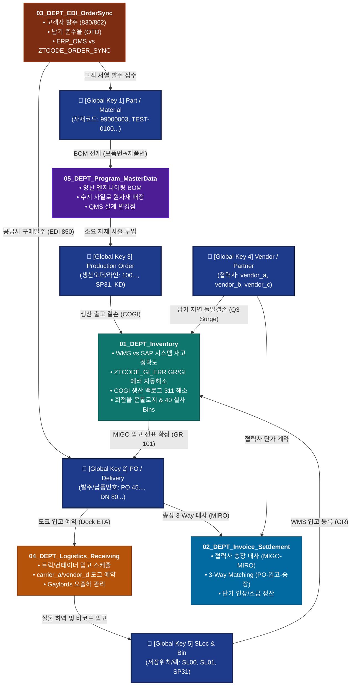

# ACME Manufacturing 전사 데이터 온톨로지 및 다부서(Multi-DEPT) 지식그래프 명세서
> **문서 버전**: `v1.0` | **최종 갱신**: `2026-10-25` | **총괄 관제**: `00_HQ_TaskManager` (PMO & Data Architecture)  
> **적용 범위**: `01_M365MCP` 산하 모든 전사 부서 (`01_DEPT_Inventory`, `02_DEPT_Invoice_Settlement`, `03_DEPT_EDI_OrderSync`, `04_DEPT_Logistics_Receiving`, `05_DEPT_Program_MasterData`)

---

## 🌐 1. 전사 데이터 온톨로지(Enterprise Data Ontology) 아키텍처 개요

본 문서는 ACME Manufacturing (Plant P001 Headlamp & P002) 가상 조직 산하의 **여러 부서(DEPT)들이 신설·확장될 때, 각 부서의 독립적인 DB들이 거대한 의미론적 네트워크(Semantic Network)로 상호 연결되도록 규정하는 전사 데이터 연결망 청사진**입니다.

각 부서는 SQLite의 파일 락(Lock) 충돌을 방지하기 위해 **물리적으로 전용 DB를 분리 운용**하되, 전사 레벨에서는 **"5대 불변 엔터티(Golden Keys)"를 매개체로 완벽히 결합된 하나의 지식그래프(Knowledge Graph)**처럼 유기적으로 데이터를 상호 운용합니다.

---

## 🏛️ 2. 전사 5대 부서 간 데이터 흐름 및 온톨로지 연결망 (Cross-Department Knowledge Graph)



---

## 🔑 3. 전사 5대 불변 핵심 엔터티 (Universal Golden Keys)

전사의 모든 신설 부서와 Job은 아래 5대 핵심 엔터티의 표준 명명 규칙을 반드시 준수하여 스키마를 구성해야 합니다. 이를 통해 부서가 10개, 20개로 늘어나도 별도의 복잡한 데이터 변환 없이 즉각적인 온톨로지 결합이 가능해집니다.

| 엔터티 구분 | 전사 표준 컬럼명 | 데이터 예시 | 온톨로지 연결 도메인 및 역할 |
| :--- | :--- | :--- | :--- |
| **1. Part / Material**<br>(부품 및 원자재) | `material` 또는 `item_cd` | `99000003`<br>`TEST-0001`<br>`99000032-V` | **전사 최상위 마스터 키**: 모든 재고 수량, 이동전기(311), 생산 백로그(COGI), 자재 회전일수, 송장 단가 대사, 엔지니어링 BOM의 중심축. |
| **2. Purchase Order**<br>(구매발주 & 납품) | `po_number`, `deliv_number` | `4599000008`<br>`8000987654` | **조달 및 정산 체인**: EDI 발주서(03_DEPT) ➔ 물류 도크 도착(04_DEPT) ➔ SAP 입고(GR MIGO, 01_DEPT) ➔ 송장 정산(MIRO 3-Way Match, 02_DEPT). |
| **3. Production Order**<br>(생산오더 & 공정) | `prod_order`, `line_code` | `1002345678`<br>`SP31`, `KD`, `R02` | **제조 및 소요 체인**: 양산 BOM 소요량(05_DEPT) ➔ 사출/조립 라인 투입 ➔ COGI 백로그 결손(01_DEPT) ➔ 긴급 재고 보충(01/02 JOB). |
| **4. Vendor / Partner**<br>(협력사 & 공급처) | `vendor_code`, `vendor_name` | `V100345` (vendor_a)<br>`V100892` (vendor_b)<br>`V100010` (vendor_c) | **공급망 및 대금 체인**: 협력사 납기 지연(돌발 결품, 01/03_JOB) ➔ 컨테이너 회송(04_DEPT) ➔ 송장 단가 분쟁 및 정산(02_DEPT). |
| **5. Storage Location**<br>(저장위치 & 랙 빈) | `plant`, `sloc`, `bin_code` | `P001` (Plant)<br>`SL00` ~ `SL03`, `SP31`<br>`R01-02-03` | **물리 공간 체인**: 도크 하역(`SL00`) ➔ 창고 입고(`SL01/SL02`) ➔ 생산 라인(`SP31`) ➔ 순환실사 40 Bins 및 MB1B 311 이동 경로. |

---

## 📑 4. 부서 간 상호 연계 온톨로지 매트릭스 (Cross-DEPT Relationship Matrix)

신규 부서가 추가될 때 기존 부서들과 맺게 되는 핵심 온톨로지 관계(Triple: `Subject - Predicate - Object`) 정의입니다:

### ① `01_DEPT_Inventory` ⇄ `02_DEPT_Invoice_Settlement` (자재 ⇄ 송장 정산)
- **온톨로지 명제**: `[01_Inventory: GR Transaction (MIGO)]` **`verifies`** `[02_Invoice: Vendor Invoice (MIRO)]`
- **데이터 결합 키**: `material` + `po_number`
- **비즈니스 가치**:
  - 협력사(vendor_a, vendor_b)에서 송장을 청구했을 때, `01_DEPT`의 SQLite DB(`inventory_history.db` 및 SAP 입고 기록)와 1초 만에 대사하여 **"실제 창고에 입고된 수량(GR)만큼만 송장을 자동 승인"**하는 3-Way Matching 구현.

### ② `01_DEPT_Inventory` ⇄ `03_DEPT_EDI_OrderSync` (자재 ⇄ 발주/EDI)
- **온톨로지 명제**: `[03_EDI: Customer 862 Order]` **`drives`** `[01_Inventory: Stock Consumption & Safety Stock]`
- **데이터 결합 키**: `material` (고객사 OEM 품번 ➔ ACME P001 자재코드 매핑)
- **비즈니스 가치**:
  - 고객사(OEM A, OEM B/C)의 일일 조립 서열이 변동될 때, `01_DEPT`의 회전율 온톨로지(`material_turnover_ontology.json`)와 실시간 결합하여 결품 위험 사전 경보.

### ③ `01_DEPT_Inventory` ⇄ `04_DEPT_Logistics_Receiving` (자재 ⇄ 물류 입고)
- **온톨로지 명제**: `[04_Logistics: Inbound Truck Dock Scan]` **`clears`** `[01_Inventory: ZTCODE_GI_ERR GR Interface Error]`
- **데이터 결합 키**: `po_number` + `material` + `container_barcode`
- **비즈니스 가치**:
  - 물류 트럭이 도크(`SL00`)에 도착하여 바코드를 찍는 즉시, `01_JOB_GR_GI_Error`의 `gr_error_snapshots` 테이블에서 대기 중이던 입고 에러를 감지하여 연쇄 자동 해소.

### ④ `01_DEPT_Inventory` ⇄ `05_DEPT_Program_MasterData` (자재 ⇄ 양산 BOM/사일로)
- **온톨로지 명제**: `[05_Program: Engineering BOM Revision]` **`rebalances`** `[01_Inventory: COGI Production Backlog]`
- **데이터 결합 키**: `prod_order` + `parent_material` + `component_material`
- **비즈니스 가치**:
  - 사출기 원소재 레진(PC, ABS 등) 수지 사일로 배정 정보와 COGI 결품 백로그를 실시간 매칭하여, BOM 오등록으로 인한 가짜 백로그와 실물 결품을 완벽 분리.

---

## 🛠️ 5. 부서 간 데이터 결합을 위한 3대 기술 표준 (Technical Protocols)

각 부서의 DB가 물리적으로 독립되어 있어도, 전사 관제 및 상호 연계를 위해 다음 3대 기술 표준을 준수합니다:

### 1. SQLite `ATTACH DATABASE` 표준 연계 뷰 (Virtual Federated View)
타 부서의 DB 데이터 조회가 필요한 배치 분석기(`00_HQ_TaskManager` 관제탑 등)는 SQLite의 `ATTACH DATABASE`를 표준 네임스페이스로 호출합니다:

```python
# HQ 통합 관제 엔진 예시 (00_HQ_TaskManager/pipeline_monitor.py)
import sqlite3

conn = sqlite3.connect("00_HQ_TaskManager/db/hq_orchestrator.db")
conn.execute("ATTACH DATABASE '01_DEPT_Inventory/01_JOB_GR_GI_Error/db/gr_gi_history.db' AS inv_gi;")
conn.execute("ATTACH DATABASE '01_DEPT_Inventory/04_JOB_SystemReconciliation/db/system_reconciliation.db' AS inv_rec;")
conn.execute("ATTACH DATABASE '02_DEPT_Invoice_Settlement/db/settlement.db' AS inv_set;")

# 단일 SQL로 부서 간 데이터 원샷 결합 조회
query = """
SELECT 
    rec.material,
    rec.diff_qty,
    rec.financial_exposure,
    gi.doc_number as recent_311_doc,
    set_item.invoice_status
FROM inv_rec.accuracy_material_snapshot rec
LEFT JOIN inv_gi.transfer_posting_history gi ON rec.material = gi.material
LEFT JOIN inv_set.invoice_items set_item ON rec.material = set_item.material
WHERE rec.diff_qty != 0;
"""
```

### 2. 전사 공통 온톨로지 레지스트리 (`00_HQ_TaskManager/ontology/`)
- 부서 간 공통으로 참조하는 마스터 데이터(품목 회전일수, 협력사 마스터, 라인-창고 토폴로지 등)는 개별 DB에 중복 저장하지 않고, `00_HQ_TaskManager/ontology/`에 **단일 진실 원천(Single Source of Truth, JSON/SQLite)**으로 중앙 발행합니다.
- 예: `material_turnover_ontology.json` (1,705개 부품 1년치 통계 온톨로지).

### 3. 신규 부서(DEPT) 생성 시 온톨로지 자동 등록 프로토콜 (SOP)
신규 부서 생성 CLI(`org_manager.py create-dept`) 실행 시 다음 절차를 자동 수행합니다:
1. `XX_DEPT_<이름>/DATABASE_ARCHITECTURE.md` 자동 템플릿 생성.
2. 부서 내 테이블 설계 시 본 문서의 **"전사 5대 불변 핵심 엔터티(`material`, `po_number` 등)"** 컬럼 명칭 필수 상속.
3. 본 문서(`ENTERPRISE_DATA_ONTOLOGY.md`)의 다이어그램 및 관계 매트릭스에 신규 부서 노드 자동 반영.

---

## 📌 6. 부서별 세부 스키마 문서 바로가기 (Schema Sitemap)

- **재고/자재 부서 통합 DB 스키마**: [01_DEPT_Inventory/DATABASE_ARCHITECTURE.md](file:///%USERPROFILE%/Workspace/manufacturing-agent-org/01_M365MCP/01_DEPT_Inventory/DATABASE_ARCHITECTURE.md)
  - `inventory_history.db` (1.17 GB 빅데이터)
  - `gr_gi_history.db` (실시간 311 전표)
  - `backlog_history.db` (COGI 생산 백로그)
  - `system_reconciliation.db` (WMS vs SAP 전사 공식 정확도 96.56%)
- **HQ 관제 및 전사 조직 지침**: [00_HQ_TaskManager/ORGANIZATION_GROUND_RULES.md](file:///%USERPROFILE%/Workspace/manufacturing-agent-org/01_M365MCP/00_HQ_TaskManager/ORGANIZATION_GROUND_RULES.md)
- **전사 플랫폼 총괄 README**: [01_M365MCP/README.md](file:///%USERPROFILE%/Workspace/manufacturing-agent-org/01_M365MCP/README.md)
