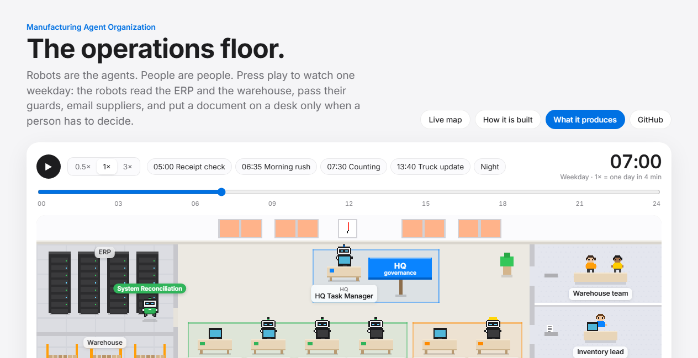
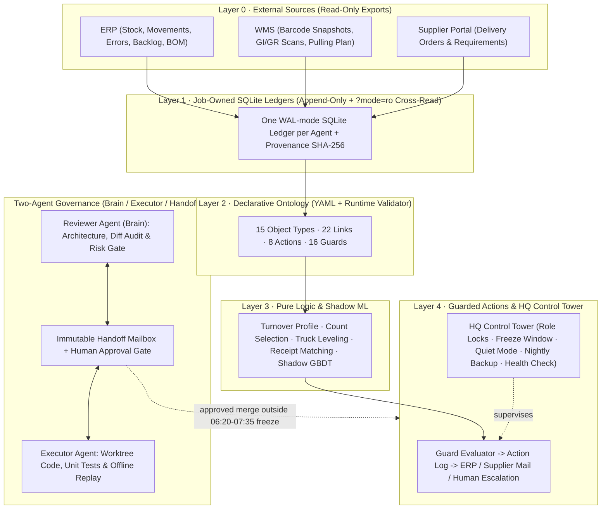

# Manufacturing Agent Organization

[](https://github.com/Miaou360/manufacturing-agent-org/actions/workflows/ci.yml)
[](https://miaou360.github.io/manufacturing-agent-org/)
[](https://miaou360.github.io/manufacturing-agent-org/demo/outputs.html)
[](https://miaou360.github.io/manufacturing-agent-org/demo/index.html)

A manufacturing plant's inventory lives in two systems: the **ERP** and the **warehouse system (WMS)**. They drift apart every day — postings fail, receipts lag behind physical scans, and boxes sit somewhere other than where the screen says. People used to hunt these differences down one by one.

This repository is the **autonomous operations team** that reconciles them on a daily schedule. Ten specialized agents across two departments, coordinated by an HQ control tower, do four things every working day:

- read ERP, WMS, and supplier-portal snapshots into append-only ledgers;
- execute guarded, reversible fixes when every safety check passes;
- level supplier truck plans and audit next-morning receipts against the last plan actually sent;
- hand people a short, evidence-backed decision list whenever a guard stops automation.

**This is a curated, runnable extract of a production plant system.** The five-layer ontology, guard logic, and change-control governance come directly from production. Real company/plant data and desktop ERP/portal adapters stay private; everything here runs deterministically offline on synthetic plant data.

[](https://miaou360.github.io/manufacturing-agent-org/)

---

## Architecture

Five data/control layers separate raw system exports from real-world side effects, while a two-agent change-control loop governs how the codebase itself evolves.



| Layer | Responsibility | In This Repository |
| :--- | :--- | :--- |
| **0 · Sources** | Raw exports from ERP, WMS, and supplier portal | `adapters/` (interfaces + offline fakes) |
| **1 · Ledgers** | One SQLite ledger per agent; append-only snapshots with file SHA-256; `?mode=ro` across boundaries | `ledgers/` |
| **2 · Ontology** | 15 object types, 22 links, 8 actions, 16 guards validated at runtime; unimplemented guards refuse to run | [`ontology/`](ontology/) · [`docs/ONTOLOGY.md`](docs/ONTOLOGY.md) |
| **3 · Logic** | Pure functions computing derived properties (`turnover_profile`, `count_selection`, `truck_leveling`, `mismatch_cause`, `receipt_matching`) | `logic/` |
| **4 · Actions** | The only code allowed to mutate state or contact external systems; logs every guard outcome to `action_log` | `actions/` |
| **Agents & HQ** | Scheduled actors plus HQ freeze windows, ERP session isolation, quiet-day holds, and health checks | [`agents/schedule.yaml`](agents/schedule.yaml) · [`docs/ARCHITECTURE.md`](docs/ARCHITECTURE.md) |

---

## Brain / Executor / Handoff Governance Model

Because autonomous agents also maintain their own code, **no agent may self-approve a production change**. Code changes follow a strict three-party protocol:

| Role | What It Owns | What It Cannot Do |
| :--- | :--- | :--- |
| **Reviewer Agent ("Brain")** | Designs specifications, audits `git diff`, checks statistical & domain evidence, inspects dry-run replays against the last real morning, and approves or rejects branches. | Never edits production files directly or merges without human sign-off. |
| **Executor Agent** | Implements changes in an isolated git worktree (`wt/*`), writes regression tests, runs offline replays and secret scans, and posts verbatim evidence to the mailbox. | Never commits directly to `main`, never skips preview gates, and never deploys during the morning freeze (`06:20–07:35`). |
| **Human Owner** | Holds final authority over plant operating rules, external supplier enablement, live ERP posting policies, and every merge to `main`. | Receives concise, evidence-backed briefs instead of raw diffs or alert spam. |
| **Handoff Mailbox** | Append-only, timestamped Markdown threads exchanging questions, diffs, verbatim script outputs, and approval status between Brain and Executor. | Existing turns are immutable — every reply creates a new numbered file for a complete audit trail. |

---

## Safety-Guard Catalogue

Every automated side effect is gated by explicit, unit-tested safety checks. When any guard fails, the agent **never forces the change** — it holds the item, alerts the owner, or hands a concise reason to a person.

| Guard / Control | Layer | What It Prevents | Fail-Safe Outcome |
| :--- | :---: | :--- | :--- |
| `persistent_difference` | Action | Acting on ERP/WMS interface latency instead of a real gap (requires 2 snapshots >=15 min apart, older <=60 min). | `HANDED_TO_PERSON` |
| `nothing_in_flight` | Action | Posting a transfer while a warehouse receipt or issue is still en route to ERP (prevents double-booking). | `HANDED_TO_PERSON` |
| `accuracy_not_down` | Action | Moving ERP stock in a way that lowers overall plant stock accuracy just to clear a local error. | `HANDED_TO_PERSON` |
| `not_receipt_linked` & `protected_movement` | Action | Auto-clearing interface errors tied to goods receipts or protected movement types (`101/102/122/561`). | `HANDED_TO_PERSON` |
| `UNKNOWN_VERIFY` anti-double-post | Runtime | Reposting an ERP transfer when the save button returned a blank/timed-out status bar before nightly movement reconciliation confirms whether it posted. | Halts retry; flags `Pending_Verify` |
| `fresh_snapshot` (<=24 h) | Action | Sending the warehouse floor a cycle-count list built on a stale snapshot. | `HELD` + Owner alert |
| `count_scope` & `recent_match_skip` | Action | Counting non-eligible storage locations or recounting recently matched bins with unchanged barcodes. | Filtered per box |
| `facts_only` | Action | Turning blank floor counts into zero or inferring quantities from free-text notes. | Blank stays `NULL` |
| `no_shortage` & `trailer_cap` & `minimal_change` | Action | Pushing supplier deliveries later (pull forward only), overloading trailers, or disturbing non-overloaded trucks. | Bounded leveling |
| `output_verified` (V1–V6) | Action | Silently sending a truck plan whose totals disagree with portal exports or repeat lines. | `SENT_WITH_FLAGS` + Owner alert |
| `owner_approved_recipients` (double-lock) | Action | Sending external supplier mail before explicit written owner approval (`mode == "live"` AND `live_approved == True`). | Diverted to owner only |
| `receipt_completeness_guard` (`G6`) | Action | Sending false-shortage supplier notices after a partial WMS receipt download (`<50%` weekday baseline). | `HELD` + Owner alert |
| `sent_plan_plan_of_record` (`SENT_BUT_UNREADABLE`) | Action | Judging suppliers against a recomputed portal baseline when the last actually emailed plan attachment is missing/corrupted. | External blocked; owner-only alert |
| **Dedicated ERP Role Locks & Idle Guard** | HQ Runtime | Touching active human ERP windows; serializes ERP writes under a single-writer mutex and opens dedicated read/write sessions. | Waits or aborts cleanly |
| **Holiday Quiet Mode + Dated Exceptions** | HQ Runtime | Sending routine operational/supplier mail on plant closure days while still keeping daily ledgers alive. | `HELD_QUIET_DAY` locally; alerts still fire |
| **Read-Only Cross-Ledger (`?mode=ro`)** | Ledger | One agent's bug corrupting another agent's SQLite database. | OS-enforced read-only URI |
| **Pre-Commit Privacy & Secret Scanner** | CI / Git | Committing `.env` credentials, real emails, user home paths, or SQLite DBs. | CI & commit blocked |

Details: [`docs/SAFETY.md`](docs/SAFETY.md) · Design rationale: [`docs/DECISIONS.md`](docs/DECISIONS.md) · Operator recovery: [`docs/RUNBOOK_TEMPLATE.md`](docs/RUNBOOK_TEMPLATE.md).

---

## A Day in the Life (`02:15 → 18:00`)

One typical Tuesday across HQ, Inventory (`00–06`), and Logistics (`00, 02, 03`):

| Time | Agent | What Happens | Output / Guard Triggered |
| :---: | :--- | :--- | :--- |
| **02:15** | **Inventory 06** · Data Collector | Exports prior-day ERP material movements (`MB51`), converts server timestamps to plant local time, registers any newly seen movement types. | Append-only `ops_raw` ledger updated |
| **03:10** | **HQ** · Task Manager | Runs SQLite online `.backup()` + `PRAGMA integrity_check` + Git bundle archive for all permanent ledgers to off-machine cloud storage. | Verified nightly backup manifest |
| **04:15** | **Inventory 05** · Release Lag | Scans rack bins for boxes released to production >2 business days ago that have not physically cleared. | Ranked release-lag report |
| **05:45** | **Inventory 06** · Data Collector | Captures pre-freeze forward pulling demand (`D`, `D+1`, `D+2`). | Pulling-plan snapshot |
| **06:20** | **Inventory 02** · Backlog Clear | Captures pre-refresh production backlog snapshot; **morning freeze begins (`06:20–07:35`)** — zero code merges allowed. | Baseline backlog snapshot |
| **06:40** | **Logistics 00** · Truck Dispatch | Downloads supplier portal orders, checks completeness, levels overloaded trailers (pull-forward only), validates `V1–V6`. | Per-supplier truck plans (AM) |
| **06:45** | **Inventory 04** · System Recon | Compares full-plant ERP vs WMS stock positions, tracks chronic mismatches and financial exposure. | Daily accuracy score & register |
| **06:50** | **Inventory 00** · Stock Accuracy | Recomputes turnover profiles, applies box-level `count_scope` and 7-day cooldown, builds risk + random-baseline count list. | Floor count sheet (freshness-gated) |
| **07:18** | **Inventory 01** · GR/GI Errors | Runs pre-draft accuracy-maximizing transfers, re-verifies ERP stock fail-closed, prepares deletion candidates for human approval. | Deletion candidate list (owner review) |
| **07:30** | **Logistics 02** · Receipt Check & **Inv 01** | Reconciles yesterday's receipts against **last-sent truck plans** (gated by `G6` completeness); dispatches daily GI error summary. | Supplier status mail + GI daily report |
| **07:35** | **HQ** · Morning Summary | Audits all scheduled slots, scheduler parity, ledger growth, and `03:10` backup freshness (`?mode=ro` only). **Morning freeze ends.** | Owner morning brief (`[ALERT]` if any fail) |
| **07:45** | **Logistics 03** · GR Reconciliation | 4-pass read-only matching of WMS receipt bundles vs ERP `101/102/122` documents; surfaces silent missing ERP posts. | 9-class receipt reconciliation workbook |
| **08:15–08:30** | **Inventory 02** · Backlog Clear | Runs guarded backlog transfers + second-pass refresh on fresh ERP snapshots, then sends one consolidated backlog team report. | Guarded transfers + team report |
| **09:15** | **Inventory 00** · Shadow ML | Trains gradient-boosted model on confirmed past audits (`run_date < today`) in strict shadow mode — zero emails, zero floor edits. | Shadow ranking CSV + overlap metric |
| **09:30** | **Warehouse Team** (People) | Returns physical bin counts; facts-only ingest separates timing movements from true discrepancies and closes the same-day feedback loop. | Ground-truth `CountResult` rows |
| **13:40** | **Logistics 00** · Truck Dispatch | Downloads refreshed portal demand for tomorrow and dispatches updated supplier truck plans (PM). | Per-supplier truck plans (PM) |
| **Every `:00`** | **Inventory 01** · Continuous Daemon | 24/7 hourly loop clearing safe interface errors and posting accuracy-preserving or stock-neutral roundtrip transfers under the ERP write lock. | Continuous `action_log` & transfer ledger |

---

## Quick Start (100% Offline)

```bash
pip install -r requirements.txt

# 1. Run one complete guarded agent job on the tiny anonymized demo dataset (<1s)
python -m demo
# or: make demo

# 2. Run a full multi-agent simulated plant day (all 6 built-in safety scenarios)
python -m simulation.run_day --seed 7 --date 2026-11-24
# or: make day

# 3. Run all verification gates (privacy/GitGuard + pytest + offline demo)
python tools/privacy_guard.py && python -m pytest -q
# or: make check
```

### What `python -m demo` Shows Immediately

Using the 4-part synthetic dataset in [`demo/sample_dataset.json`](demo/sample_dataset.json), `python -m demo` runs the **Interface-Error & Stock-Transfer Agent** end-to-end offline and writes `out/demo/demo_summary.md` + `out/demo/demo_action_log.csv`:

| Synthetic Material | Scenario Tested | Expected Guard Outcome |
| :--- | :--- | :--- |
| `MAT-DEMO-001` | Persistent `311` gap (two snapshots 30 min apart), no in-flight receipt, accuracy improves | **`DONE`** — error cleared & transfer posted |
| `MAT-DEMO-002` | Receipt-linked interface error + unposted WMS receipt `BC-DEMO-2001` in flight | **`HANDED_TO_PERSON`** — blocked by `not_receipt_linked` & `nothing_in_flight` |
| `MAT-DEMO-003` | Balanced source location (`40/40`) where moving stock would degrade plant accuracy | **`HANDED_TO_PERSON`** — blocked by `accuracy_not_down` |
| `MAT-DEMO-004` | Protected movement type (`561`) | **`HANDED_TO_PERSON`** — blocked by `protected_movement` |

---

## Repository Map & Documentation

```text
.github/workflows/ci.yml   GitHub Actions CI (ubuntu-latest, pip cache, privacy_guard, pytest, demo)
ontology/                  objects.yaml · links.yaml · actions.yaml · registry.py
ledgers/                   append-only SQLite snapshot store with provenance, schema.sql
logic/                     turnover_profile · count_selection · truck_leveling · mismatch_cause · receipt_matching
actions/                   guards · action_log · one guarded module per action
adapters/                  interfaces + offline fakes for ERP, WMS, supplier portal, mail
agents/                    schedule.yaml · run_agent.py
simulation/                full-day synthetic plant + run_day
demo/                      python -m demo offline runner + sample_dataset.json + GitHub Pages floor UI
tools/                     privacy_guard.py (standalone CI banned-trace & GitGuard scanner)
tests/                     ontology registry, guards, logic invariants, privacy, demo, full-day smoke
docs/                      ARCHITECTURE · ONTOLOGY · SAFETY · DECISIONS · RUNBOOK_TEMPLATE
Makefile                   make demo · make day · make test · make guard · make check
```

| Document | Audience & Focus |
| :--- | :--- |
| [`docs/ARCHITECTURE.md`](docs/ARCHITECTURE.md) | Five-layer architecture, ledger boundaries, Brain/Executor governance, agent schedule |
| [`docs/ONTOLOGY.md`](docs/ONTOLOGY.md) | 15 object types, 22 links (auto-verified Mermaid diagram), 8 actions, 16 guards |
| [`docs/SAFETY.md`](docs/SAFETY.md) | Complete guard catalogue, runtime rules, holiday quiet mode, change-control process |
| [`docs/DECISIONS.md`](docs/DECISIONS.md) | Architecture Decision Records (ADRs 1–15): choice, rationale, and trade-offs |
| [`docs/RUNBOOK_TEMPLATE.md`](docs/RUNBOOK_TEMPLATE.md) | One-page-per-agent operational runbook template for unattended days |

---

## One Plant, Three Views

Three sibling repositories model the same synthetic plant with consistent parts, suppliers, and racks:

| Repository | Question It Answers |
| :--- | :--- |
| [3d-warehouse-visualizer](https://github.com/Miaou360/3d-warehouse-visualizer) ([live](https://miaou360.github.io/3d-warehouse-visualizer/)) | Where is every pallet, how old is it, and will the racks hold next month's plan? |
| [sequencing-pulling-list](https://github.com/Miaou360/sequencing-pulling-list) ([live](https://miaou360.github.io/sequencing-pulling-list/)) | Which of those pallets should be pulled to the line, and in what order? |
| **manufacturing-agent-org** (this repository) | Who keeps the systems in step every day, and what do they hand to people? |

## License

MIT License — Copyright (c) 2026 Seunghun Yea. See [LICENSE](LICENSE).
