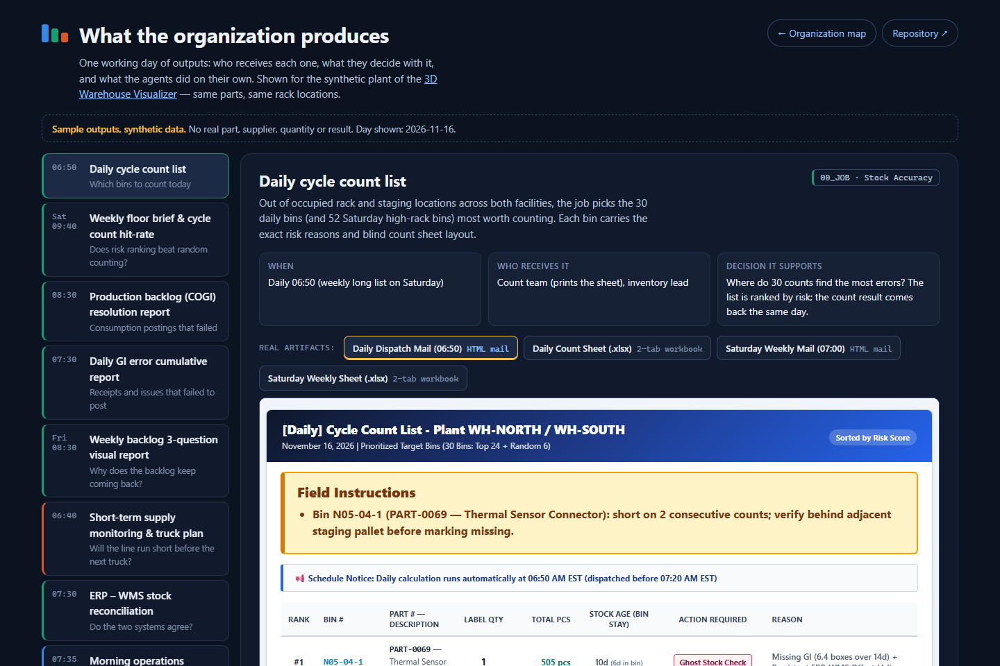
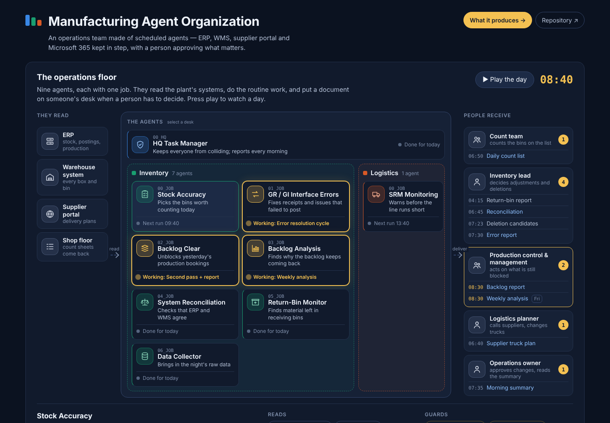

# Manufacturing SCM & Inventory Multi-Agent Organization (`manufacturing-agent-org`)

A plant's stock lives in two systems, the ERP and the warehouse system, and they drift apart every day: postings fail, receipts arrive late, boxes are in a different place than the screen says. People used to find these one by one. This repository is the operations team that now does it on a schedule: a set of agents that read both systems every morning, fix what is safe to fix, and hand people a short list of what needs a decision.

[](https://miaou360.github.io/manufacturing-agent-org/)
[](https://miaou360.github.io/manufacturing-agent-org/demo/outputs.html)
[](https://miaou360.github.io/manufacturing-agent-org/demo/architecture.html)

- **[What it produces](https://miaou360.github.io/manufacturing-agent-org/demo/outputs.html)** — one working day of outputs: who receives each one, what they decide with it, what the agents did on their own.
- **[How it is built](https://miaou360.github.io/manufacturing-agent-org/demo/architecture.html)** — data model (one SQLite ledger per job, read-only cross-ledger links), end-to-end swim-lane flow, cycle-count decision pipeline, and runtime safety guards.
- **[How it is organized](https://miaou360.github.io/manufacturing-agent-org/)** — departments and jobs, the 21 scheduled tasks on a 24-hour clock (press *Play the day*), the path from source systems to action, and the human approval loop.

[](https://miaou360.github.io/manufacturing-agent-org/demo/outputs.html)

## What it produces

| Output | When | Who uses it | Decision it supports |
| --- | --- | --- | --- |
| [Daily cycle count list](https://miaou360.github.io/manufacturing-agent-org/demo/outputs.html#count) | 06:50 | Count team, inventory lead | Which 28 bins are most worth counting today? Ranked by risk, with the reason for each bin; results come back the same day and are compared with a random baseline. |
| [Interface error resolution](https://miaou360.github.io/manufacturing-agent-org/demo/outputs.html#interface) | Hourly (24h) | Inventory planner | Which failed receipt / issue postings were fixed safely, and which need a person? |
| [Production backlog report](https://miaou360.github.io/manufacturing-agent-org/demo/outputs.html#backlog) | 08:15 | Production control, management | What still blocks yesterday's production from being booked, and who acts on each line? |
| [ERP – WMS reconciliation](https://miaou360.github.io/manufacturing-agent-org/demo/outputs.html#recon) | 07:30 | Inventory lead, finance | Is stock accuracy moving, and which differences are real rather than timing? |
| [Supplier truck loading plan](https://miaou360.github.io/manufacturing-agent-org/demo/outputs.html#srm) | 06:40, 13:40 | Suppliers, logistics planner | What goes on each fixed truck today and tomorrow so no trailer is overloaded and no line runs short? |
| [UPDATED truck plan (PM refresh)](https://miaou360.github.io/manufacturing-agent-org/demo/outputs.html#srm-updated) | On demand | Changed suppliers only | After a late portal order change, which exact cells changed since the 13:40 plan? |
| [Supplier delivery-status file](https://miaou360.github.io/manufacturing-agent-org/demo/outputs.html#delivery) | Every 10 min | Suppliers, logistics planner | After a truck unloads, did any shortfall create a shortage before the next truck — and how many boxes are needed? |
| [Weekly backlog analysis](https://miaou360.github.io/manufacturing-agent-org/demo/outputs.html#weekly) | Fri 08:30 | Plant management | Which root cause should be fixed so the items stop coming back? |
| [Morning operations summary](https://miaou360.github.io/manufacturing-agent-org/demo/outputs.html#morning) | 07:35 | Operations owner | Did every slot run, and is anything broken before the shift starts? |

The real outputs are e-mails and workbooks about a real plant, so none of them is in this repository. The sample outputs use the same formats on a synthetic plant and are generated by `tools/build_sample_outputs.py` (fixed seed).

**How the agents are kept safe.** An agent posts to the ERP only when three guards agree: the difference has persisted across snapshots, no receipt or issue for the part is in flight, and plant stock accuracy does not go down. Everything else is explained and handed to a person. Code changes follow the same idea: branch, review by a second agent, approval by a person, merge.

## Logistics: from order to the truck

**The problem.** Portal delivery orders frequently bunch forty or more carts onto one afternoon truck while earlier trucks run light, exceeding trailer capacity. Worse, when a truck arrives short, people used to find out hours later when the assembly line ran low — after the supplier's next truck had already left the dock.

**What the agents do.** Twice a day (`06:40` for today, `13:40` for tomorrow, plus a desktop one-click PM refresh when orders change late), **`00_JOB` (Order Dispatch)** projects stock every 2 hours, levels overloaded trucks, and sends each supplier a 2-sheet loading plan (`Truck plan` + `2-hour detail`, with `Total carts (boxes)` per truck; late refreshes highlight only cells changed since `13:40` and mail only affected suppliers). Throughout the shift, **`02_JOB` (Receipt Tracking)** polls warehouse barcode receipts every 10 minutes, freezes each truck's plan at departure, pairs `Plan` vs `Delivered` rows as trucks close, and prepares a supplier delivery-status file with red shortfalls and a plain-English `Warning` before the next truck departs. (`03_JOB` GR reconciliation and `01_JOB` delivery-rate analysis complete the planned four-job department.)

**The two leveling rules:**
1. **No shortage ever.** Orders are only pulled forward to earlier trucks, never pushed later, so projected 2-hour stock never drops below zero (or below the arrival safety buffer).
2. **Change the SRM order as little as possible.** A supplier's schedule is untouched unless a truck exceeds `1.7×` the daily truck average (by at least 6 boxes) or exceeds its physical trailer cap (e.g., `33` carts). Only whole boxes with safe stock margin are pulled forward, largest box count first, so the fewest part lines change.

## One plant, three views

The three repositories describe the same synthetic two-facility plant (Facility North, Facility South) with the same parts and rack locations:

| Repository | Question it answers |
| --- | --- |
| [3d-warehouse-visualizer](https://github.com/Miaou360/3d-warehouse-visualizer) ([live](https://miaou360.github.io/3d-warehouse-visualizer/)) | Where is every pallet, how old is it, and will the racks hold next month's plan? |
| [sequencing-pulling-list](https://github.com/Miaou360/sequencing-pulling-list) ([live](https://miaou360.github.io/sequencing-pulling-list/)) | Which of those pallets should be pulled to the line, and in what order? |
| **manufacturing-agent-org** (this one) | Who keeps the systems in step every day, and what do they hand to people? |

[](https://miaou360.github.io/manufacturing-agent-org/)

Structure and schedules on the live map mirror the running system as of 2026-11-16 across both the Inventory and Logistics departments. System codes, addresses, part numbers and partner names are generalized or left out.

---

## Architecture Overview

```text
01_M365MCP/
├── 00_HQ_TaskManager/               # Shared governance, SAP/Selenium locks, env & security guards
│   ├── git_auto_sync.py             # Pre-commit secret/PII/binary scanner (GitGuard)
│   ├── persistence_guard.py         # Multi-snapshot variance persistence guardrail
│   ├── sap_healer.py / sap_lock.py  # SAP GUI session recovery & single-writer mutex
│   ├── wms_mapping.py               # Storage location (SLoc) & settled-state objective function
│   └── ztcode_stock_guard.py        # ERP GR/GI interface collision & chain protection guard
└── 01_DEPT_Inventory/               # Autonomous Inventory & Warehouse Operations Department
    ├── 00_JOB_StockAccuracy/        # Daily/Weekly risk-scored & stratified cycle-count engine + LightGBM pipeline
    ├── 01_JOB_GR_GI_Error/          # Continuous 1h (24h) ERP-WMS GI/GR interface error classification & auto-clearing
    ├── 02_JOB_Backlog_Clear/        # COGI production backlog root-cause engine & accuracy-preserving MB1B resolver
    ├── 03_JOB_Backlog_Analysis/     # MB51 movement decomposition & longitudinal backlog analytics mart
    ├── 04_JOB_SystemReconciliation/ # Plant-wide SAP vs. WMS stock reconciliation & variance tracking
    ├── 05_JOB_SL01_R_Bins/          # Receiving/return staging bin aging & clearance automation
    └── 06_JOB_Data_Collector/       # Daily SAP MB51 material document ledger collector & retention manager
└── 02_DEPT_Logistics/               # Autonomous Inbound Supply & Truck Dispatch Department
    ├── 00_JOB_SRM_Monitoring/       # 06:40/13:40 truck load leveling, 33-cart cap & diff-only PM refresh
    ├── 02_JOB_Delivery_Check/       # 10-min WMS GR barcode tracking & pre-cutoff DeliveryStatus warnings
    ├── 03_JOB_GR_Reconciliation/    # (Planned) WMS physical receipt vs. ERP 101 posting reconciliation
    └── 01_JOB_Delivery_Rate/        # (Planned) Longitudinal supplier on-time & in-full (OTIF) analytics
```

## Key Design Principles

1. **Zero-Collision Concurrency & Resource Guardrails**: Single-instance Selenium/SAP GUI mutexes, SQLite WAL mode, read-only URI inspection, and bounded worker pools (`<= 4` workers) so background jobs never contend with foreground workstation apps.
2. **Accuracy-Preserving ERP Automation**: Every automated transfer (`MB1B 311/312`) is gated by a multi-snapshot persistence check, active GR/GI interface chain protection, and a strict plant-wide accuracy objective function (`Delta_Accuracy >= 0`).
3. **Ground-Truth Fact Integrity**: Cycle-count results store only verified physical counts; unverified fields remain `NULL` and weak proxies are strictly isolated for ML experimentation.
4. **Configuration & Secret Isolation**: Zero credentials, internal hostnames, customer/vendor names, or real part numbers in source code. All environment-specific parameters are injected exclusively via uncommitted `.env` (`.env.example` template provided).

## Quick Start

1. **Install Dependencies**:
   ```bash
   pip install -r requirements.txt
   ```
2. **Configure Environment**:
   ```bash
   cp .env.example 01_M365MCP/.env
   # Fill in local SAP/WMS/M365 settings in 01_M365MCP/.env (never committed)
   ```
3. **Install Pre-Commit Security Guard**:
   ```bash
   python 01_M365MCP/00_HQ_TaskManager/git_auto_sync.py install-hook --repo .
   ```
4. **Run Unit Test Suite (Synthetic Fixtures)**:
   ```bash
   pytest 01_M365MCP/00_HQ_TaskManager/tests
   pytest 01_M365MCP/01_DEPT_Inventory/01_JOB_GR_GI_Error/tests
   ```

---

## 한국어 요약 (Overview in Korean)

제조 현장의 **SAP ERP — WMS(창고관리시스템) — Microsoft 365** 간 데이터 정합성과 재고 정확도를 자율 유지하기 위해 설계된 가상 조직형 멀티 에이전트 파이프라인(`00_HQ` 본부 + `01_DEPT_Inventory` 재고부서 `00`~`06` JOB + `02_DEPT_Logistics` 물류부서 `00`·`02` 가동 및 `01`·`03` 계획 JOB)입니다. 모든 민감 설정·계정·호스트·실데이터는 `.env` 환경변수로 분리되어 있으며, 합성 픽스처 기반 단위 테스트(`pytest`)와 커밋 전 보안 스캐너(`GitGuard`)를 포함합니다.

## License

MIT License — Copyright (c) 2026 Seunghun Yea. See [LICENSE](LICENSE).
