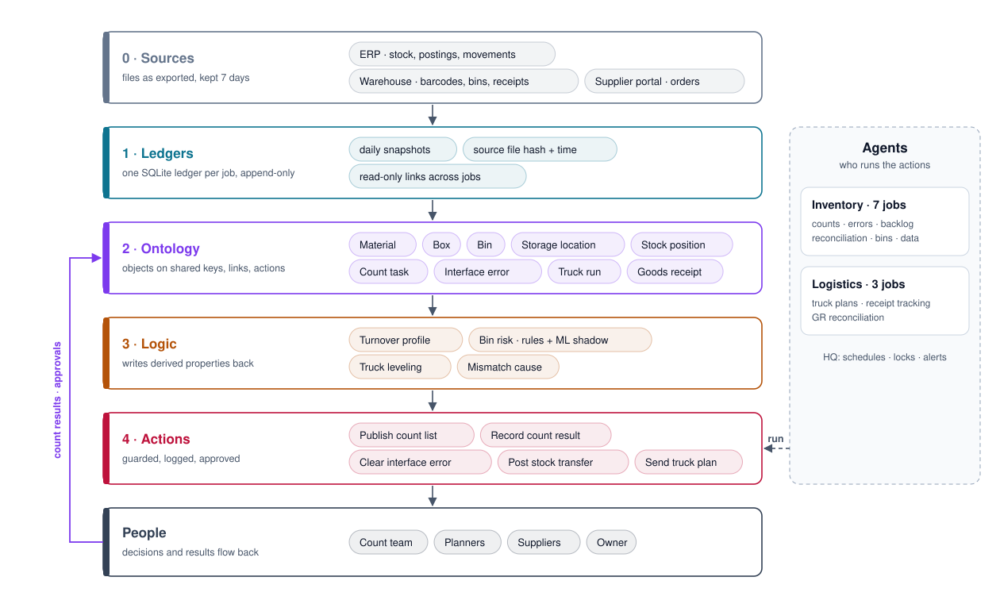

# Architecture

The system has five layers, plus the agents that run on top of them. Data moves down the layers. Decisions and count results come back up as new facts.

<picture>
  <source media="(prefers-color-scheme: dark)" srcset="img/layers-dark.svg">
  
</picture>

## Layer 0 — Sources

**What lives here:** files exactly as each system exports them.
- From the ERP: stock, movements, failed interface postings, production backlog.
- From the warehouse system: every barcode, with its bin, storage location and receipt time.
- From the supplier portal: delivery orders by time window.

**Rules:**
- Raw files are kept for seven days, then deleted.
- Nothing in a later layer depends on a raw file still being there, because every load is copied into a ledger first.

**In this repository:** `adapters/` defines the interfaces and fake implementations. The real adapters drive a desktop ERP client and a web portal, so they stay private.

## Layer 1 — Ledgers

**What lives here:** one SQLite ledger per job. Each job owns its ledger, and no job writes into another job's ledger.

**Rules:**
- **Append-only snapshots.** Every load adds a snapshot (`snapshot_id`) and never overwrites the last one, so any past morning can be replayed.
- **Provenance.** `ledger_provenance` records, for each load:
  - the source name;
  - the SHA-256 of the file;
  - the capture time;
  - the row count.
- **Read-only across boundaries.** A job that needs another job's data opens that ledger with `?mode=ro`.
- **Write-ahead logging (WAL) and online backups.** The ledgers run in WAL mode and are backed up nightly, without stopping the jobs.

**Tables:** see [`ledgers/schema.sql`](../ledgers/schema.sql).

| Group | Tables |
| --- | --- |
| Masters | `material_master`, `bin_master`, `zone_master`, `sloc_master`, `supplier_master` |
| Daily snapshots | `wms_box_snapshot`, `stock_position_snapshot`, `interface_error_snapshot`, `delivery_order_snapshot`, `backlog_snapshot` |
| Created by actions | `count_task`, `count_result`, `stock_transfer`, `truck_run`, `goods_receipt` |
| Bookkeeping | `ledger_provenance`, `action_log` |

## Layer 2 — Ontology

**What lives here:** the meaning of the data:
- object types, each with a key and properties;
- links between object types;
- actions with their guards.

It is defined in YAML and validated by `ontology/registry.py`. `registry.materialize()` builds one read-only view per object type on top of the ledgers, so logic and actions query *Bins* and *Boxes*, not snapshot tables. Details: [ONTOLOGY.md](ONTOLOGY.md).

## Layer 3 — Logic

**What lives here:** pure functions that read object properties and return new property values. Every derived value is written back with the date it was computed for (`profile_as_of`, `snapshot_date`), so a later reader can see how old it is.

| Module | Result |
| --- | --- |
| `turnover_profile` | Dwell days per box. Trimmed mean, median and mover class per material. Median dwell per zone. |
| `count_selection` | Today's count tasks in three lanes. **Risk** is ranked by risk score and carries a reason. **Random baseline** is what makes the hit rate measurable. **High rack** is the weekly reach-truck count. |
| `truck_leveling` | Assigns order lines to truck runs. Orders are pulled forward only, never pushed later. Changes happen only when a truck is over its cap or over the overload threshold. |
| `mismatch_cause` | One of five cause classes per count result: line scan miss, empty bin, bin-to-bin miss, part missing, wrong part. |
| `receipt_matching` | Assigns each receipt to the truck run whose window contains it. |

## Layer 4 — Actions

**What lives here:** the only code that changes an object or talks to the outside world (ERP, supplier files, mail). Every action follows the same five steps:

1. Load its definition from the registry. Refuse to run if a declared guard is not implemented.
2. Evaluate every guard (`GuardResult(id, passed, reason)`).
3. Write one row to `action_log`:
   - who ran it, and when;
   - what it read;
   - every guard result as JSON;
   - the outcome;
   - the approval.
4. Act through an adapter, or do what the action declares for a failed guard: hold it and alert the owner, hand it to a person, or send it with flags.
5. Record what it produced (`outputs_ref`).

## Agents

The ten production agents are defined in [`agents/schedule.yaml`](../agents/schedule.yaml): seven inventory jobs and three logistics jobs, coordinated by HQ. Five of them run in the simulation. Two shared rules sit with HQ:

- **Morning freeze, 06:20–07:35.** No code changes and no heavy batch jobs while the morning outputs are produced.
- **Single-writer ERP lock.** Only one agent may hold the ERP session at a time.

One simulated day runs in schedule order. Each step takes its time from `schedule.yaml`:

| Time | Agent | What it does |
| --- | --- | --- |
| 05:00 | Receipt Check | Yesterday's receipts against yesterday's truck plans: delivery status, owner only |
| 06:40 | Truck Dispatch | Today's truck plans, leveled and verified, one per supplier |
| 06:45 | System Reconciliation | Stock positions: ERP against the warehouse system |
| 06:50 | Stock Accuracy | Turnover profile, then today's count list |
| 08:00 | GR/GI Errors | One hourly cycle: clear safe errors, post guarded transfers |
| 09:30 | Warehouse team (people) | Count results come back and are recorded as facts |

The afternoon truck run, the backlog jobs, GR reconciliation, release lag and the collector are listed in `schedule.yaml` with their real times, but are not simulated.

## Why it is built this way

See [DECISIONS.md](DECISIONS.md). In short:
- **Separate ledgers** keep one job's failure from corrupting another job's data.
- **An explicit ontology** keeps rules about the plant (which storage locations are counted, which movements are protected) on the objects, instead of scattered across jobs.
- **Actions with guards and a log** make every automated change explainable after the fact.
