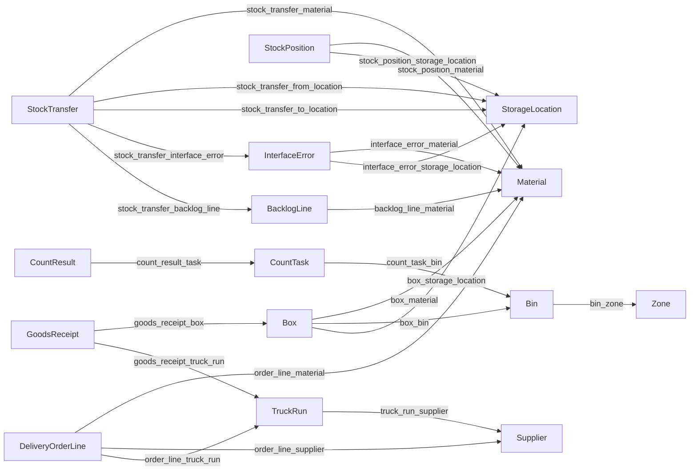

# Ontology model

The agents don't think in tables. They act on things in the plant, like parts, boxes, bins and trucks, and they support the decisions people make about them. This page describes that model. It has four parts:

- the **object types**;
- the **links** between them;
- the **actions** that change them, with the guards each action must pass;
- the **logic** that reads object properties and writes results back.

The model is data, not prose. It is defined in [`ontology/objects.yaml`](../ontology/objects.yaml), [`ontology/links.yaml`](../ontology/links.yaml) and [`ontology/actions.yaml`](../ontology/actions.yaml), and [`ontology/registry.py`](../ontology/registry.py) validates it on every run. The registry checks four things:

1. Every link points at existing types and properties.
2. Every derived property names the logic module that writes it.
3. Every action reads and writes only declared types and properties.
4. Every guard an action declares is implemented in [`actions/guards.py`](../actions/guards.py). If one is missing, the action refuses to run.

Storage stays simple: one SQLite ledger per job, with read-only links across ledgers. The ontology is the shared meaning that sits on top of the ledgers. Every ledger uses the same key for the same thing (material number, barcode, bin code, storage location, supplier id), and that is why the read-only links work. Departments and jobs are not object types. They are the actors that run the actions.

## 1. Object types

| Object type | Key | Main properties | Ledger table |
| --- | --- | --- | --- |
| Material | material id | description, pieces per box, mover class, turnover profile *(derived)*, small-part flag *(heuristic)* | `material_master` |
| Box | barcode | material, quantity, received at, bin, storage location, status (in storage / issued to production / issued without a receipt), dwell days *(derived)* | `wms_box_snapshot` |
| Bin | bin code | facility, zone, rack level, count scope (daily / weekly / excluded), last counted, skip-until | `bin_master` |
| Zone | zone code | median dwell days *(derived)*, look-back window *(derived)* | `zone_master` |
| StorageLocation | SLoc code | facility, count-eligible | `sloc_master` |
| StockPosition | material + SLoc + date | ERP quantity, WMS quantity, difference, consecutive days different | `stock_position_snapshot` |
| CountTask | run + bin | lane (risk / random baseline / high rack), rank, risk score, reason, boxes on the list | `count_task` |
| CountResult | run + bin | counted boxes (blank = not counted), difference, cause class *(derived)*, field notes | `count_result` |
| InterfaceError | error id | material, movement type, SLoc, quantity, tied to a receipt, status | `interface_error_snapshot` |
| StockTransfer | ERP document number | material, from / to SLoc, quantity, status, the error or backlog line it clears | `stock_transfer` |
| BacklogLine | backlog line id | material, production order, SLoc, quantity *(in the model; not simulated)* | `backlog_snapshot` |
| Supplier | supplier id | trailer cap in carts, truck slots | `supplier_master` |
| DeliveryOrderLine | order + material + window | ordered boxes, truck run *(set by truck leveling)* | `delivery_order_snapshot` |
| TruckRun | truck run id | supplier, date, slot, planned carts *(derived)*, status | `truck_run` |
| GoodsReceipt | barcode | material, quantity, received at, posted in the ERP, truck run *(set by receipt matching)* | `goods_receipt` |

The storage location belongs to the box, not the bin: one bin can hold boxes booked in different storage locations. That is why counting scope is decided per box (`StorageLocation.count_eligible`) and per bin (`Bin.count_scope`), and never by bin-name patterns.

## 2. Links

This diagram is generated by `registry.to_mermaid()`, and a test checks that this page matches it.

Some links change over time: which bin a box is in, and which storage location it is booked in. These are kept in daily snapshots instead of being overwritten. Some links are not in the source data at all. They are set by the action or the logic that decides them:
- `count_task_bin` is set by publishing a count list;
- `order_line_truck_run` is set by truck leveling;
- `goods_receipt_truck_run` is set by receipt matching.

## 3. Actions

An action is the only way an object changes. Every run writes one row to the action log with:
- who ran it, and when;
- what it read;
- the result of each guard;
- the outcome.

When a guard fails, the action does not force the change. It holds the item and alerts the owner, hands it to a person, or sends it with flags, as [`actions.yaml`](../ontology/actions.yaml) declares.

| Action | Changes | Performed by | Guards |
| --- | --- | --- | --- |
| Publish count list | creates CountTask; sets Bin.skip_until | stock-accuracy agent, 06:50 | `count_scope`, `recent_match_skip` (7 days daily / 14 days weekly, unchanged barcode set), `fresh_snapshot` (≤ 24 h) |
| Record count result | creates CountResult; sets Bin.last_counted_at | warehouse team (person) | `facts_only` |
| Clear interface error | InterfaceError.status | interface-error agent, hourly | `not_receipt_linked`, `protected_movement` |
| Post stock transfer | creates StockTransfer; StockPosition.erp_qty | interface-error agent | `persistent_difference` (two snapshots ≥ 15 min apart, older one ≤ 60 min), `nothing_in_flight`, `accuracy_not_down` |
| Send truck plan | assigns DeliveryOrderLine → TruckRun | order-dispatch agent, 06:40 and 13:40 | `no_shortage`, `minimal_change`, `trailer_cap`, `output_verified` |
| Send delivery status | TruckRun.status | receipt-tracking agent, 05:00 | `owner_approved_recipients` |
| Change count scope | Bin.count_scope, StorageLocation.count_eligible | owner (person) | `reviewed_change` |
| Raise system alert | none | any agent | `owner_only` |

## 4. Logic

Logic reads object properties and writes its results back as properties. It is not the ontology itself.

| Module | Reads | Writes |
| --- | --- | --- |
| `turnover_profile` | Box receipts and issues | Box dwell days; Material trimmed mean, median and mover class; Zone median dwell and look-back window |
| `count_selection` | Bin, Box, StorageLocation, CountResult, Material | CountTask rank, lane, risk score and reason; Bin skip-until |
| `truck_leveling` | DeliveryOrderLine, Supplier, StockPosition | DeliveryOrderLine truck run; TruckRun planned carts |
| `mismatch_cause` | CountResult, Box, GoodsReceipt | CountResult cause class |
| `receipt_matching` | GoodsReceipt, TruckRun | GoodsReceipt truck run |

The production system also scores the same bins with a gradient-boosted model in shadow mode. The model replaces the rules only if it beats them on the same days' count results.

## 5. The decision loop

The count side works like this:
1. Publishing a count list creates CountTasks.
2. The floor counts them.
3. Each CountResult becomes a label for the next list.

The loop closes the same day. The random-baseline lane is what keeps the measured hit rate honest.

The ERP side has the same shape:
1. An InterfaceError or BacklogLine leads to a proposed StockTransfer.
2. The guards decide whether it is posted or handed to a person.
3. The next snapshot of the StockPosition shows whether the difference actually closed.

## 6. What the production system still has to catch up on

This repository is the cleaned-up model. Three gaps remain in the production code it was extracted from:

- **Scope rules lived in code instead of on the objects.** Bin-name patterns partly decided which bins could be counted. Two bins whose stock was booked entirely in an excluded storage location reached a daily list. The rule looked at bin names, not at where the stock was booked. Production now reads one list of excluded storage locations in every list producer. The next step is a single Bin / Storage-location master shared by every job, as modeled here.
- **Links across ledgers are read-only joins, not a shared object store.** Each job owns its ledger, and nothing writes across a boundary. One older write-back across two ledgers is scheduled to move into its owner's ledger.
- **Some production names are older than this model.** A table and an engine there still carry "ontology" in their names. They hold only the Material turnover profile — the derived properties of one object type — not the ontology.
